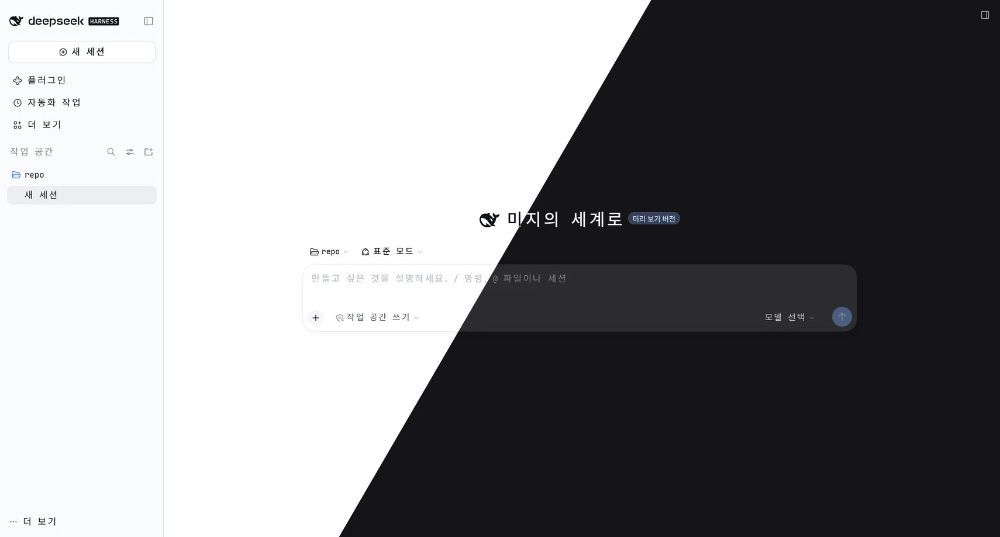

# @dungsil/dsh-plugin-locale-ko



[Deepseek Harness](https://github.com/deepseek-ai/deepseek-harness) 한국어 플러그인

## 특징

- UI 번역 (플러그인 관리 페이지 포함)
- 공식 플러그인과 내장 플러그인의 이름·설명 번역
- 한국어 IME 조합을 Enter로 확정할 때 메시지 전송

## 구성 요소

**플러그인 → 설치됨 → 한국어 UI → 구성 요소**에서 두 기능을 각각 켜거나 끌 수 있습니다. 처음 설치하면 둘 다 활성화됩니다.

| 구성 요소  | 기능                                                             |
| ---------- | ---------------------------------------------------------------- |
| 한국어 UI  | 한국어 언어 등록, UI 번역, 공식·내장 플러그인의 이름과 설명 번역 |
| 한국어 IME | 대화 입력창에서 Enter로 한글 조합을 확정할 때 메시지 전송        |

IME만 끄면 한국어 번역은 유지되고 입력창은 DSH의 기본 IME 처리로 돌아갑니다. 번역만 끄면 한국어는 언어 목록에서 빠지지만 IME 처리는 계속 작동합니다. 번역을 다시 켜면 이전 한국어 선택이 복원됩니다.

IME 처리는 UI 언어와 관계없이 적용됩니다. Shift/Alt+Enter는 변경하지 않으며, Enter로 IME 후보를 선택하면서 조합을 끝내는 경우에도 메시지를 전송합니다.

## 설치

```sh
dsh plugin --profile web add @dungsil/dsh-plugin-locale-ko
```

`web`은 사용할 프로필 이름으로 바꾸세요.

## 플러그인 화면에서 업데이트

버전 조회와 in-place 업데이트를 지원하는 DSH에서는 **플러그인 → 설치됨 → 이 플러그인 → 버전 → 업데이트**로 새 버전을 설치할 수 있습니다. 설치 조건과 실패 복구는 모든 플러그인에 적용되는 [공통 업데이트 안내](../../README.md#공통-in-place-업데이트)를 따릅니다.

한국어 선택은 다시 로드한 뒤에도 유지됩니다. 함께 설치된 IME 구성 요소도 번들의 의존성 범위에 따라 갱신되며, 기존 이벤트 처리는 해제 후 다시 등록됩니다.
