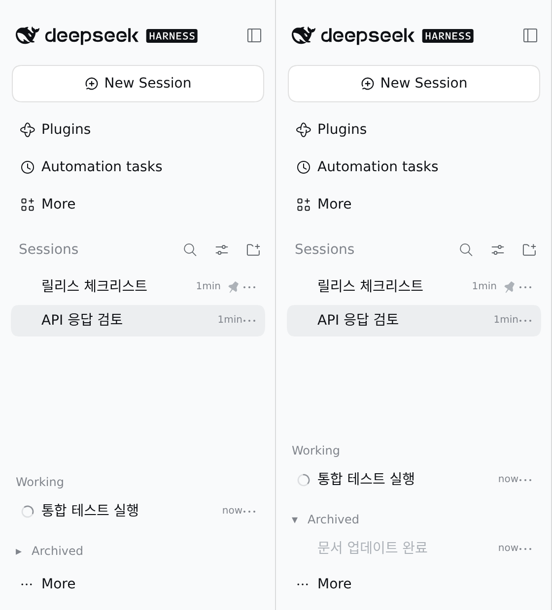

# @dungsil/dsh-plugin-sidebar-inbox

DSH의 기존 사이드바 모양을 유지하면서, 프로젝트별 목록을 T3 Code Nightly처럼 상태별 목록으로 배치합니다.



DSH `0.2.2-alpha.2`의 영어 UI에서 예시 세션으로 촬영한 화면입니다. 왼쪽은 Archived가 접힌 기본 상태이고, 오른쪽은 펼친 상태입니다.

## 배치 규칙

| 영역     | 포함되는 세션                                                                         |
| -------- | ------------------------------------------------------------------------------------- |
| Pinned   | DSH에서 고정한 세션입니다. 기존 고정을 우선합니다.                                    |
| Inbox    | 응답 확인, 승인, 계획 검토, 사용자 입력이 필요하거나 아직 열지 않은 세션입니다.       |
| Working  | 에이전트 또는 하위 에이전트가 실행 중인 세션입니다. 요청이 생기면 Inbox로 돌아옵니다. |
| Archived | DSH에서 보관한 세션입니다. 보관과 해제는 DSH의 `⋯` 메뉴에서 실행합니다.               |

각 영역에서는 최근 갱신된 세션을 먼저 표시합니다. 빈 새 세션은 기존 DSH처럼 맨 위에 둡니다.

목록 제목은 DSH UI 언어를 따릅니다. 한국어 UI에서는 `작업 중`·`보관됨`으로 표시합니다. 번역 사전은 이 플러그인이 직접 포함하므로 한국어 UI 언어 팩을 따로 설치하지 않아도 됩니다.

Pinned와 Inbox는 별도 제목 없이 위쪽 목록에 표시합니다. Working과 Archived는 목록을 스크롤해도 사이드바 하단에 붙어 있습니다. 기본값은 Working을 펼치고 Archived를 접은 상태입니다. 두 제목을 누르거나 키보드로 활성화하면 각 영역이 부드럽게 펼쳐지고 접힙니다. Archived는 세션 필터가 `모든 대화 (보관된 세션 포함)`일 때만 접을 수 있습니다. `보관된 세션만` 필터에서는 보관한 세션이 목록 전체이므로 접지 않고 그대로 표시합니다. 새로고침하면 기본값으로 돌아갑니다.

## 사용법

1. 정리할 세션의 `⋯` 메뉴에서 `세션 보관`을 선택합니다.
2. 사이드바의 세션 필터를 `모든 대화 (보관된 세션 포함)`으로 바꾸면 보관한 세션이 하단 `Archived` 영역에 접힌 채로 표시됩니다.
3. 같은 메뉴에서 `세션 보관 해제`를 선택하면 원래 자리로 돌아옵니다.

보관 여부는 DSH가 관리합니다. 이 플러그인은 보관 상태를 저장하거나 바꾸지 않으며, 보관한 세션은 언제든 복원할 수 있습니다. 실행 중이거나 사용자 응답을 기다리는 세션은 DSH가 보관 전에 작업을 먼저 중지합니다.

## 설치

DSH `0.2.1-rc.5`와 `0.2.2-alpha.2`에서 검증했습니다. 지원 범위는 `^0.2.1-rc.5`입니다. 아직 npm에 배포하지 않았다면 저장소에서 패키지를 생성하여 설치합니다.

```bash
pnpm --filter @dungsil/dsh-plugin-sidebar-inbox pack --pack-destination ../../release
dsh plugin --profile web add ./release/dungsil-dsh-plugin-sidebar-inbox-0.1.0.tgz
```

DSH의 플러그인 관리 화면에서 **Sidebar Inbox / 사이드바 수신함**을 활성화합니다.

## 동작 범위

- 기존 세션 행, 검색, 메뉴, 선택, 고정, 보관 필터를 재사용합니다. CSS로 순서만 바꾸지 않고 DSH의 목록 정렬을 갱신하므로 화면 순서와 DOM 순서가 일치합니다.
- 활성화한 동안에는 단일 목록과 상태별 정렬을 사용합니다. 수동 드래그 정렬과 프로젝트별 그룹 설정은 적용하지 않습니다. 플러그인을 비활성화하거나 정상적으로 페이지를 떠나면 이전 그룹·정렬 설정을 복원합니다.
- 보관 상태와 보관 필터는 DSH가 소유합니다. 이 플러그인은 브라우저 저장소에 상태를 남기지 않으며, 보관한 세션도 하단 영역에서 그대로 복원할 수 있습니다.
- 영역을 접고 펼 때는 160~180ms 높이 전환으로 애니메이션합니다. 운영체제의 동작 줄이기(`prefers-reduced-motion`) 설정을 켜면 애니메이션 없이 즉시 바뀝니다.
- 접힌 영역의 래퍼는 목록 행 간격을 남기지 않아, 보이는 내용이 짧아도 불필요한 세로 스크롤바가 생기지 않습니다.
- DSH의 공유 Workspace 보기 저장소와 `data-row-key`를 사용합니다. 기본 행은 교체하거나 다른 DOM 부모로 옮기지 않으며, 영역 제목만 추가합니다. DSH가 이 구조를 바꾸면 호환성 갱신이 필요합니다.

## 검증

```bash
pnpm --filter @dungsil/dsh-plugin-sidebar-inbox build
pnpm --filter @dungsil/dsh-plugin-sidebar-inbox typecheck
pnpm --filter @dungsil/dsh-plugin-sidebar-inbox test
```

자동 테스트는 분류 우선순위, 보관한 세션의 하단 배치, 보관 필터별 표시, Working과 Archived의 기본 펼침·접힘과 제목 토글, 보관 해제 반영, UI 언어 전환에 따른 제목 갱신, 기존 필터 유지, 해제 후 정렬 복원을 확인합니다.
