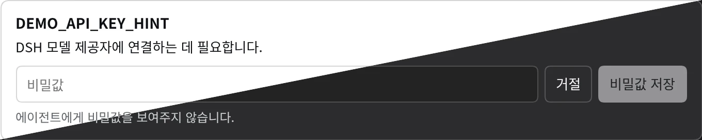

# @dungsil/dsh-plugin-tool-secret-request



DSH 에이전트가 `request_secret`을 호출하면 해당 도구 호출 위치에 비밀번호 입력 카드를 표시합니다. 팝업 없이 메시지 안에서 입력하며, 저장·거절·만료 후에는 처리 상태가 카드에 남습니다. 완료 후 DSH가 도구 기록을 접으면 해당 기록을 펼쳐 상태를 확인할 수 있습니다. 사용자가 저장한 값은 대화 기록을 거치지 않고 DSH 비밀값 저장소로 전달되며, 모델에는 참조 이름과 처리 상태만 반환됩니다.

## 설치 및 사용

DSH `0.2.1-rc.5` 이상의 웹 프로필에 설치합니다.

```sh
dsh plugin --profile web add @dungsil/dsh-plugin-tool-secret-request
```

DSH를 재시작하고 웹 UI를 연 상태에서 에이전트에 필요한 비밀값 입력을 요청합니다. 한국어 UI에서는 한국어 입력창을, 그 외 언어에서는 영어 입력창을 표시합니다. 한국어 UI 플러그인과는 별도로 설치합니다.

도구 호출 예시입니다. **호출 인자에 실제 값을 넣지 않습니다.** `ref`는 해당 DSH 기능의 `apiKeyEnv` 등에서 참조하는 이름과 일치해야 합니다.

`label`에는 키 이름이나 짧은 설명을, `reason`에는 키가 필요한 이유를 짧은 한 문장으로 작성합니다. 카드에는 제목과 요청 이유를 표시하고, 입력란 아래에는 비밀값을 에이전트에게 보여주지 않는다는 안내를 표시합니다. 기존 값을 덮어쓸 때에는 대체 안내를 추가합니다.

```json
{
  "ref": "CUSTOM_API_KEY",
  "label": "CUSTOM_API_KEY",
  "reason": "DSH 모델 제공자에 연결하는 데 필요합니다."
}
```

저장한 뒤에는 `{"status":"saved","ref":"CUSTOM_API_KEY"}`만 반환합니다. DSH 내부 소비자는 `ctx.credentials.resolve(credentialRef('CUSTOM_API_KEY'))`로 값을 사용합니다. 도구가 제공자 설정을 바꾸거나 새로운 소비자를 등록하지는 않습니다.

## 동작과 보안 경계

- `ref`, `label`, `reason`만 필수입니다. 선택 인자 `timeout_ms`는 1,000~600,000밀리초이며 기본값은 10분입니다. 결과 상태는 `saved`, `declined`, `cancelled`, `timed_out`, `unavailable`입니다. 실행 자체가 중단되면 DSH 도구 런타임이 취소 오류로 표시할 수 있습니다.
- 인증된 소유자 웹 클라이언트에서만 입력할 수 있습니다. 세션 ID와 도구 호출 ID가 모두 일치하는 메시지에만 입력란을 표시합니다. 다른 탭에서 같은 대화를 열어도 요청 하나에는 한 번만 저장할 수 있습니다. 에이전트 없는 호출, 위임된 하위 에이전트, 최근 15초 동안 입력 UI가 연결되지 않은 환경에서는 `unavailable`을 반환합니다. TUI와 ACP 전용 입력은 지원하지 않습니다.
- 값은 일반 질문 응답, 도구 인자·결과, 플러그인 오류 메시지에 포함되지 않습니다. 빈 값은 거부하고 앞뒤 공백은 보존합니다. 저장 완료·오류·카드 제거 시 입력값을 지우며, 세션을 떠났다가 돌아오면 다시 입력해야 합니다. 입력 중에도 다른 메시지와 채팅 입력창을 사용할 수 있으며, 요청은 카드의 거절 버튼으로 거절합니다. 브라우저 메모리와 인증된 전송 요청에는 원문이 존재하므로 원격 접속에는 HTTPS를 사용해야 합니다.
- 기본 DSH 저장소는 `$DSH_HOME/.credentials.yaml`에 소유자 전용 권한으로 저장합니다. **암호화 저장소나 에이전트 격리 기능은 아닙니다.** 같은 OS 계정의 프로세스와 신뢰한 다른 플러그인은 값을 읽을 수 있습니다. 호스트 전체에서 공유하며 직접 삭제할 때까지 유지합니다. 같은 참조에 저장하면 기존 값을 대체합니다. 취소 전에 사용자가 저장을 시작했다면 해당 쓰기는 완료될 수 있습니다.
- 셸 환경변수나 프로젝트 `.env`에는 자동으로 전달하지 않습니다. T3 Code의 프로젝트별 일회용 `secretRef`, 24시간 만료, 임시 파일 전달은 구현하지 않습니다. 이 플러그인은 DSH 비밀값 참조를 사용하는 기능을 위한 입력 도구입니다. 일반 애플리케이션의 환경변수 설정 도구로 사용하면 안 됩니다.

## 구현 근거

[T3 Code의 `request_secret`](https://github.com/pingdotgg/t3code/blob/30654b3e91a51937d1dba18fc83af19d8003f5ca/packages/contracts/src/orchestratorMcp.ts#L731-L773)에서 모델 요청과 비밀값 제출을 분리하는 방식을 참고했습니다. T3 Code 소스는 복사하지 않았습니다.

DSH의 일반 `ask_user_question`은 응답을 모델에 반환하므로 사용하지 않습니다. 대신 `ctx.connection.fetch`의 인증된 소유자 전용 경로에서 요청을 받고 `ctx.credentials.set`으로 저장합니다. 웹 클라이언트는 공식 `tool.call.toolview` 슬롯에 `request_secret` 카드를 등록하고, 기존 RPC 전송을 이용해 1초 간격으로 대기 요청의 공개 메타데이터만 조회합니다. 추가 HTTP 서버나 DSH 본체 수정, 대화 DOM 탐색은 필요하지 않습니다.

## 검증

```sh
pnpm --filter @dungsil/dsh-plugin-tool-secret-request test
```

실제 DSH 도구 런타임과 파일 기반 저장소를 사용해 값 보존, 결과 비노출, 파일 권한, 거절·취소·시간 초과, 권한 검사, 중복 저장 방지, 오류 정제를 검증합니다. 브라우저 번들은 React DOM 테스트로 세션·호출 격리, 입력 마스킹, 이동·저장·실패 시 값 제거, 거절과 완료 상태 재표시를 확인합니다.
