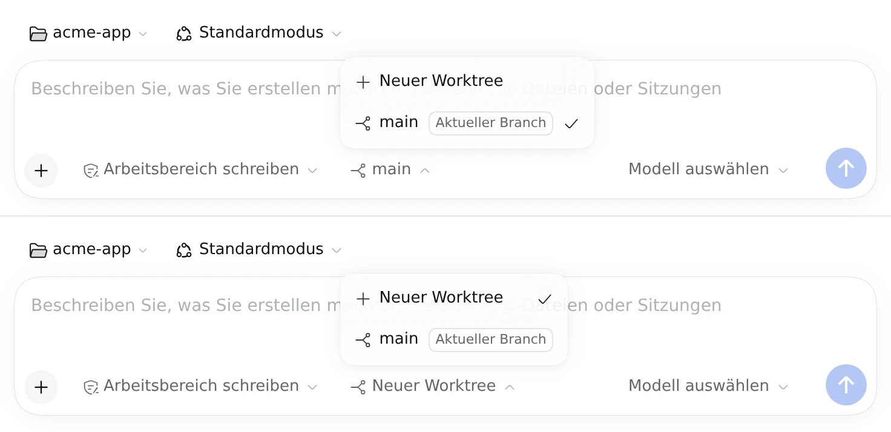
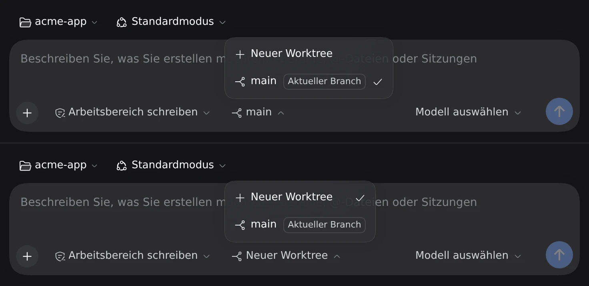

[한국어](./README.md) | [English](./README.en.md) | [简体中文](./README.zh.md) | [日本語](./README.ja.md) | [Español](./README.es.md) | [Français](./README.fr.md) | **Deutsch** | [Português](./README.pt.md) | [Русский](./README.ru.md)

# Worktree-Auswahl

`@dungsil/dsh-plugin-ui-forge-worktree`

## Vorschau

**Hell**: Oben ist der aktuelle Branch ausgewählt, unten ein neuer Worktree.

**Dunkel**: Dieselben beiden Zustände im dunklen Design.

## Funktionen

- Ersetzt die Worktree-Option, die das offizielle `@deepseek-ai/dsh-experimental-forge-bundle` auf dem Bildschirm für neue Sitzungen anzeigt, durch eine Auswahlschaltfläche im Eingabefeld.
- Wählen Sie im Menü **Neuer Worktree** oder **Aktueller Branch**. Der neue Worktree wird beim Senden der ersten Nachricht erstellt.
- Die Schaltfläche zeigt den Namen des aktuellen Branches oder **Neuer Worktree** und nach der Erstellung den Branch-Namen des Worktrees.
- Sperrt die Auswahl nach dem Start der Sitzung und deaktiviert die Option für einen neuen Worktree bei Checkouts, die keinen erstellen können. Kann die Auswahl nicht gespeichert werden, werden ein Fehler und eine Schaltfläche zum Aktualisieren angezeigt.
- Folgt der DSH-Sprache (Koreanisch, Englisch, Chinesisch, Japanisch, Spanisch, Französisch, Deutsch, Russisch, Portugiesisch) sowie dem hellen und dunklen Design.
