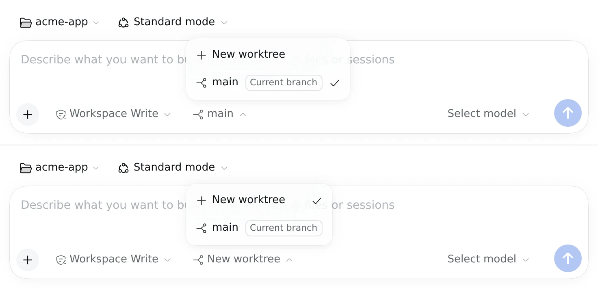
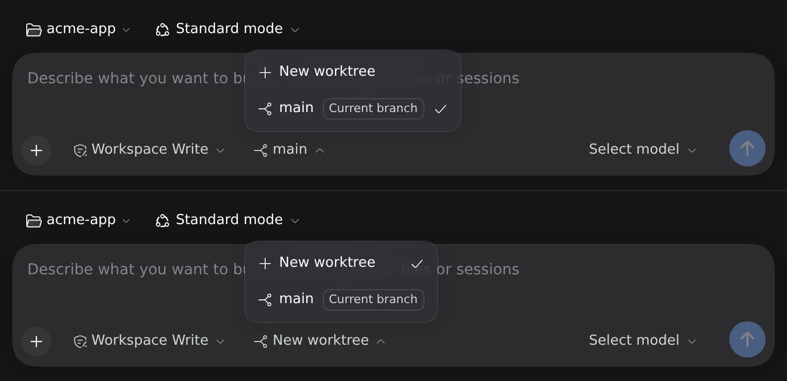

[한국어](./README.md) | **English** | [简体中文](./README.zh.md) | [日本語](./README.ja.md) | [Español](./README.es.md) | [Français](./README.fr.md) | [Deutsch](./README.de.md) | [Português](./README.pt.md) | [Русский](./README.ru.md)

# Worktree Picker

`@dungsil/dsh-plugin-ui-forge-worktree`

## Preview

**Light**: The top shows the current branch selected, and the bottom shows a new worktree selected.

**Dark**: The same two states in the dark theme.

## Features

- Replaces the worktree option that the official `@deepseek-ai/dsh-experimental-forge-bundle` shows on the New Session screen with a picker button in the composer.
- Choose **New worktree** or **Current branch** from the menu. A new worktree is created when you send your first message.
- The button shows the current branch name or **New worktree**, and the worktree's branch name once it has been created.
- Locks the selection after the session starts, and disables the new worktree option for checkouts that cannot create one. If the selection cannot be saved, it shows an error and a refresh button.
- Follows the DSH language (Korean, English, Chinese, Japanese, Spanish, French, German, Russian, Portuguese) and the light and dark themes.
