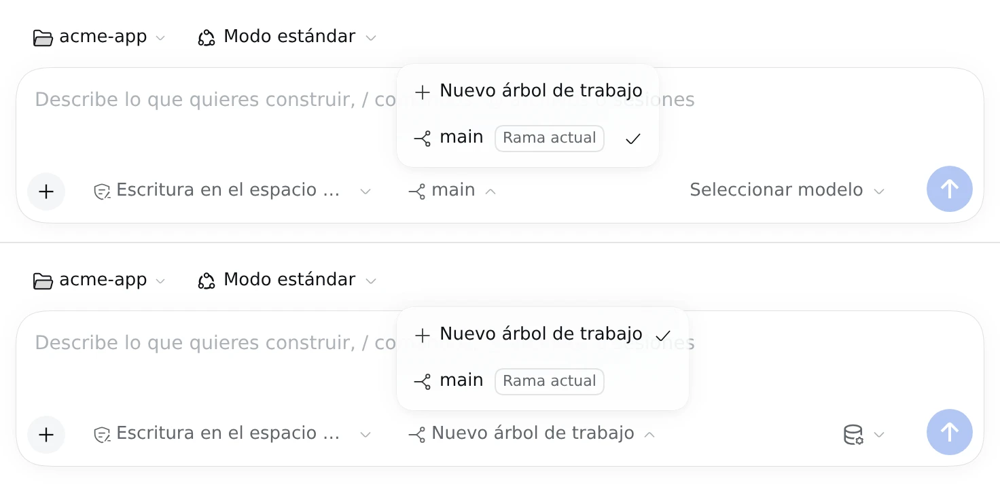
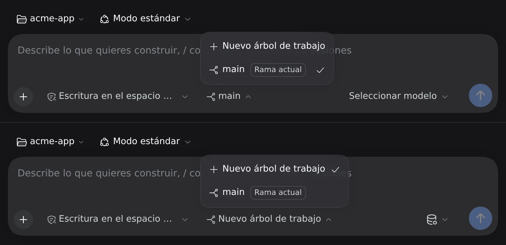

[한국어](./README.md) | [English](./README.en.md) | [简体中文](./README.zh.md) | [日本語](./README.ja.md) | **Español** | [Français](./README.fr.md) | [Deutsch](./README.de.md) | [Português](./README.pt.md) | [Русский](./README.ru.md)

# Selector de árboles de trabajo

`@dungsil/dsh-plugin-ui-forge-worktree`

## Vista previa

**Claro**: arriba está seleccionada la rama actual y abajo, un nuevo árbol de trabajo.

**Oscuro**: los mismos dos estados con el tema oscuro.

## Funciones

- Sustituye la opción de árbol de trabajo que el paquete oficial `@deepseek-ai/dsh-experimental-forge-bundle` muestra en la pantalla de nueva sesión por un botón selector en el cuadro de entrada.
- Elige **Nuevo árbol de trabajo** o **Rama actual** en el menú. El nuevo árbol de trabajo se crea al enviar el primer mensaje.
- El botón muestra el nombre de la rama actual o **Nuevo árbol de trabajo** y, una vez creado el árbol de trabajo, el nombre de su rama.
- Bloquea la selección cuando la sesión ha empezado y desactiva la opción de nuevo árbol de trabajo en los checkouts que no pueden crearlo. Si no se puede guardar la selección, muestra un error y un botón para actualizar.
- Sigue el idioma de DSH (coreano, inglés, chino, japonés, español, francés, alemán, ruso y portugués) y los temas claro y oscuro.
