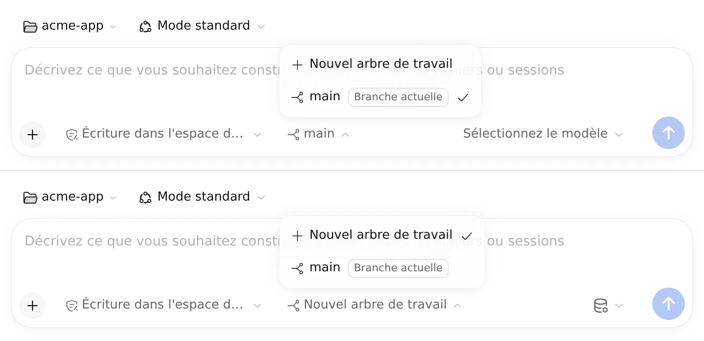
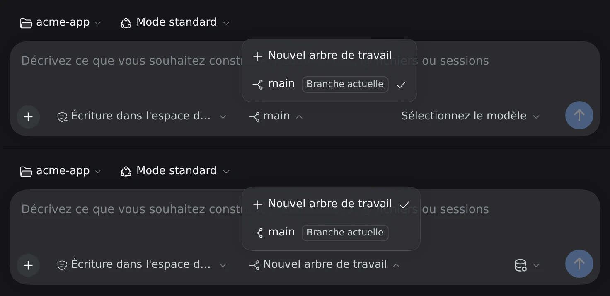

[한국어](./README.md) | [English](./README.en.md) | [简体中文](./README.zh.md) | [日本語](./README.ja.md) | [Español](./README.es.md) | **Français** | [Deutsch](./README.de.md) | [Português](./README.pt.md) | [Русский](./README.ru.md)

# Sélecteur d’arbres de travail

`@dungsil/dsh-plugin-ui-forge-worktree`

## Aperçu

**Clair** : en haut, la branche actuelle est sélectionnée ; en bas, un nouvel arbre de travail.

**Sombre** : les deux mêmes états avec le thème sombre.

## Fonctionnalités

- Remplace l’option d’arbre de travail que le paquet officiel `@deepseek-ai/dsh-experimental-forge-bundle` affiche sur l’écran de nouvelle session par un bouton de sélection dans la zone de saisie.
- Choisissez **Nouvel arbre de travail** ou **Branche actuelle** dans le menu. Le nouvel arbre de travail est créé à l’envoi du premier message.
- Le bouton affiche le nom de la branche actuelle ou **Nouvel arbre de travail**, puis le nom de la branche de l’arbre de travail une fois celui-ci créé.
- Verrouille la sélection une fois la session démarrée et désactive l’option de nouvel arbre de travail pour les checkouts qui ne peuvent pas en créer. Si la sélection ne peut pas être enregistrée, affiche une erreur et un bouton d’actualisation.
- Suit la langue de DSH (coréen, anglais, chinois, japonais, espagnol, français, allemand, russe et portugais) ainsi que les thèmes clair et sombre.
