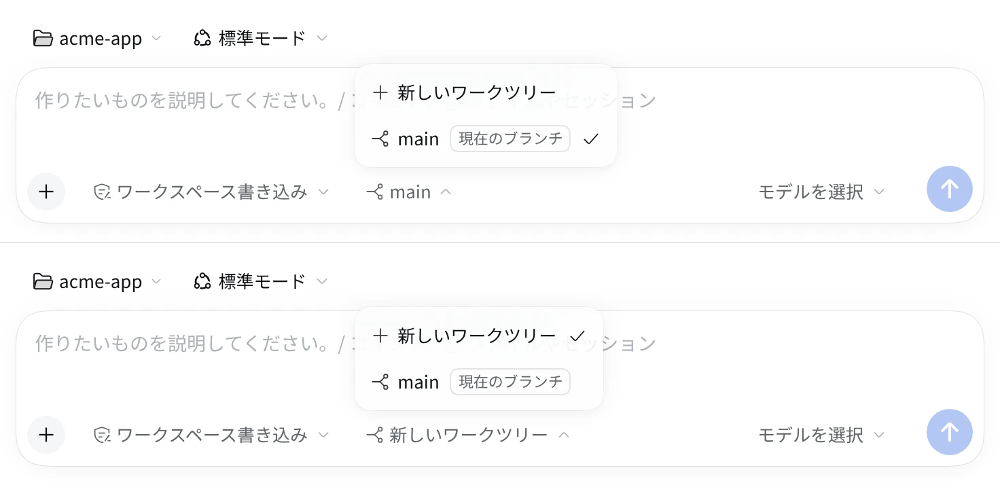
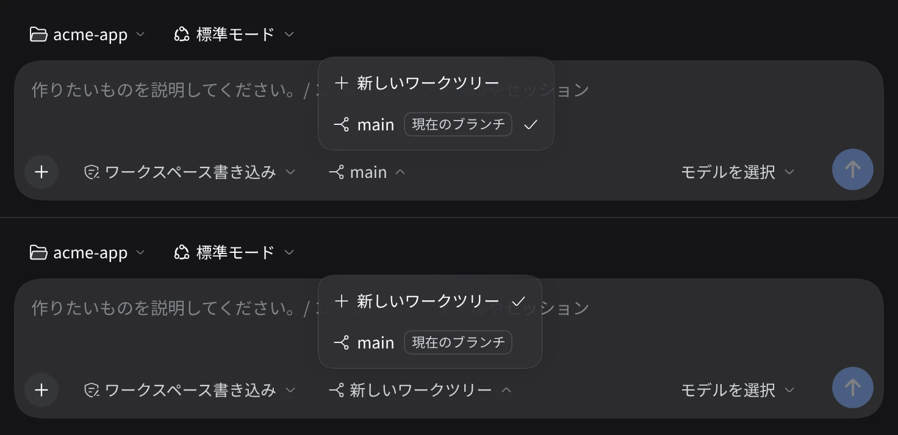

[한국어](./README.md) | [English](./README.en.md) | [简体中文](./README.zh.md) | **日本語** | [Español](./README.es.md) | [Français](./README.fr.md) | [Deutsch](./README.de.md) | [Português](./README.pt.md) | [Русский](./README.ru.md)

# ワークツリー選択

`@dungsil/dsh-plugin-ui-forge-worktree`

## プレビュー

**ライト**：上は現在のブランチ、下は新しいワークツリーを選択した状態です。

**ダーク**：同じ 2 つの状態をダークテーマで表示します。

## 機能

- 公式 `@deepseek-ai/dsh-experimental-forge-bundle` が新しいセッション画面に表示するワークツリーオプションを、入力欄の選択ボタンに置き換えます。
- メニューで**新しいワークツリー**と**現在のブランチ**のどちらかを選びます。新しいワークツリーは最初のメッセージを送信したときに作成されます。
- ボタンには現在のブランチ名または**新しいワークツリー**を表示し、ワークツリーの作成後はそのブランチ名を表示します。
- セッション開始後は選択を固定し、新しいワークツリーを作成できないチェックアウトではその項目を無効にします。選択を保存できない場合は、エラーと再読み込みボタンを表示します。
- DSH の表示言語（韓国語、英語、中国語、日本語、スペイン語、フランス語、ドイツ語、ロシア語、ポルトガル語）と、ライト・ダークテーマに従います。
