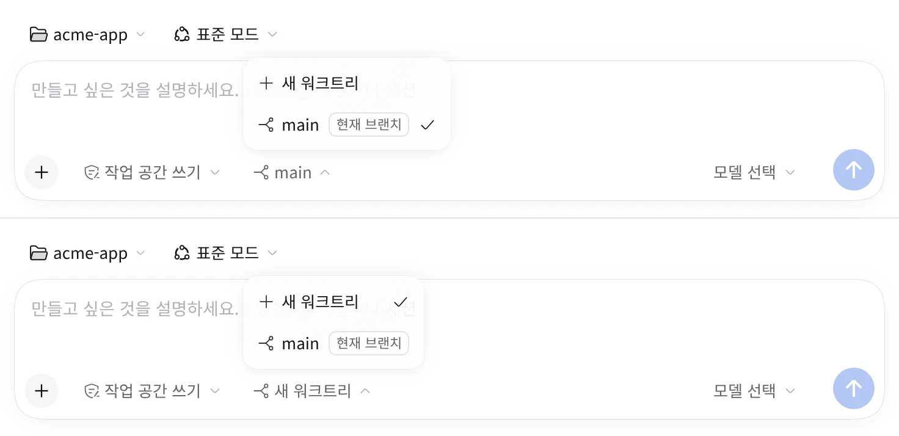
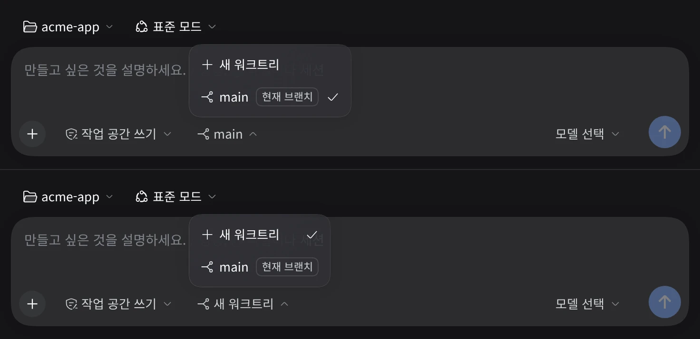

**한국어** | [English](./README.en.md) | [简体中文](./README.zh.md) | [日本語](./README.ja.md) | [Español](./README.es.md) | [Français](./README.fr.md) | [Deutsch](./README.de.md) | [Português](./README.pt.md) | [Русский](./README.ru.md)

# Worktree Picker · 워크트리 선택기

`@dungsil/dsh-plugin-ui-forge-worktree`

## 미리보기

**라이트**: 위는 현재 브랜치를, 아래는 새 워크트리를 선택한 상태입니다.

**다크**: 같은 두 상태를 다크 테마로 표시합니다.

## 기능

- 공식 `@deepseek-ai/dsh-experimental-forge-bundle`이 새 세션 화면에 표시하는 워크트리 옵션을 입력창의 선택 버튼으로 바꿉니다.
- 메뉴에서 **새 워크트리**와 **현재 브랜치** 중 하나를 고릅니다. 새 워크트리는 첫 메시지를 보낼 때 생성됩니다.
- 버튼에는 현재 브랜치 이름이나 **새 워크트리**를 표시하고, 워크트리가 생성된 뒤에는 그 브랜치 이름을 표시합니다.
- 세션이 시작된 뒤에는 선택을 잠그고, 새 워크트리를 만들 수 없는 체크아웃에서는 해당 항목을 비활성화합니다. 선택을 저장하지 못하면 오류와 새로고침 버튼을 표시합니다.
- DSH의 언어(한국어, 영어, 중국어, 일본어, 스페인어, 프랑스어, 독일어, 러시아어, 포르투갈어)와 라이트·다크 테마를 따릅니다.
