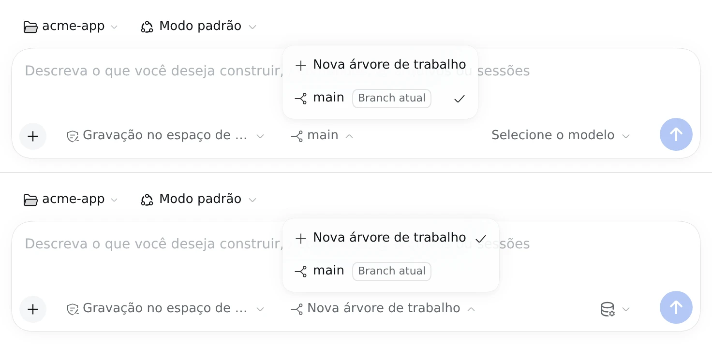
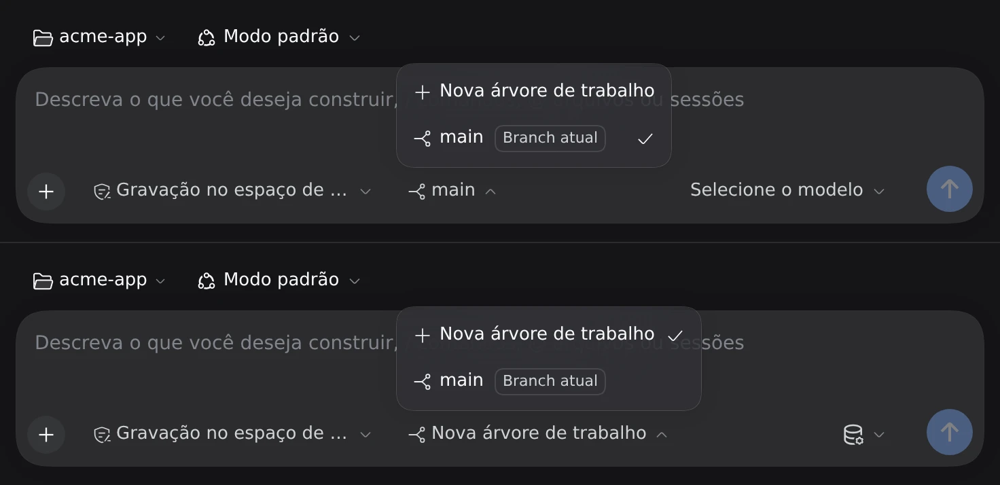

[한국어](./README.md) | [English](./README.en.md) | [简体中文](./README.zh.md) | [日本語](./README.ja.md) | [Español](./README.es.md) | [Français](./README.fr.md) | [Deutsch](./README.de.md) | **Português** | [Русский](./README.ru.md)

# Seletor de árvores de trabalho

`@dungsil/dsh-plugin-ui-forge-worktree`

## Pré-visualização

**Claro**: em cima, a branch atual está selecionada; em baixo, uma nova árvore de trabalho.

**Escuro**: os mesmos dois estados no tema escuro.

## Funcionalidades

- Substitui a opção de árvore de trabalho que o pacote oficial `@deepseek-ai/dsh-experimental-forge-bundle` mostra no ecrã de nova sessão por um botão seletor no campo de mensagem.
- Escolha **Nova árvore de trabalho** ou **Branch atual** no menu. A nova árvore de trabalho é criada quando envia a primeira mensagem.
- O botão mostra o nome da branch atual ou **Nova árvore de trabalho** e, depois de a árvore de trabalho ser criada, o nome da sua branch.
- Bloqueia a seleção depois de a sessão começar e desativa a opção de nova árvore de trabalho em checkouts que não a podem criar. Se não for possível guardar a seleção, mostra um erro e um botão para atualizar.
- Segue o idioma do DSH (coreano, inglês, chinês, japonês, espanhol, francês, alemão, russo e português) e os temas claro e escuro.
