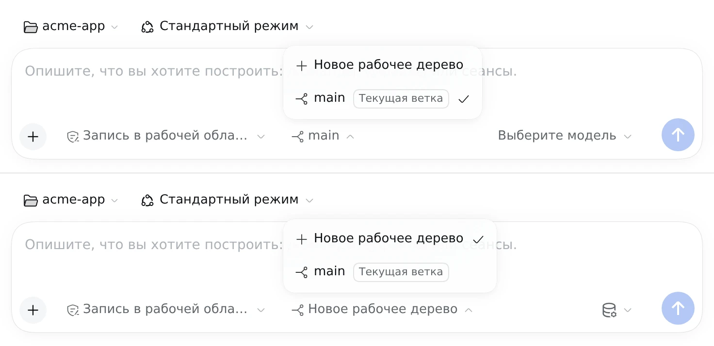
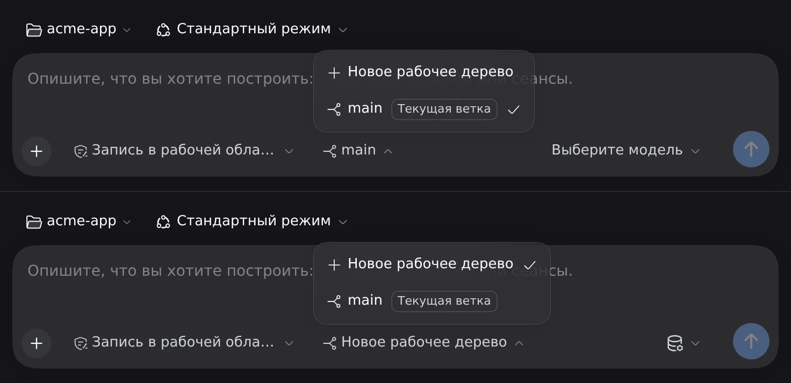

[한국어](./README.md) | [English](./README.en.md) | [简体中文](./README.zh.md) | [日本語](./README.ja.md) | [Español](./README.es.md) | [Français](./README.fr.md) | [Deutsch](./README.de.md) | [Português](./README.pt.md) | **Русский**

# Выбор рабочего дерева

`@dungsil/dsh-plugin-ui-forge-worktree`

## Предпросмотр

**Светлая тема**: сверху выбрана текущая ветка, снизу — новое рабочее дерево.

**Тёмная тема**: те же два состояния в тёмной теме.

## Возможности

- Заменяет параметр рабочего дерева, который официальный `@deepseek-ai/dsh-experimental-forge-bundle` показывает на экране новой сессии, кнопкой выбора в поле ввода.
- В меню можно выбрать **Новое рабочее дерево** или **Текущая ветка**. Новое рабочее дерево создаётся при отправке первого сообщения.
- На кнопке отображается имя текущей ветки или **Новое рабочее дерево**, а после создания рабочего дерева — имя его ветки.
- После начала сессии выбор блокируется, а для checkout, в котором нельзя создать рабочее дерево, этот пункт отключается. Если выбор не удаётся сохранить, отображаются ошибка и кнопка обновления.
- Следует языку DSH (корейский, английский, китайский, японский, испанский, французский, немецкий, русский, португальский), а также светлой и тёмной темам.
