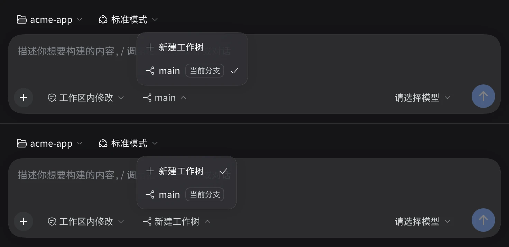

[한국어](./README.md) | [English](./README.en.md) | **简体中文** | [日本語](./README.ja.md) | [Español](./README.es.md) | [Français](./README.fr.md) | [Deutsch](./README.de.md) | [Português](./README.pt.md) | [Русский](./README.ru.md)

# 工作树选择器

`@dungsil/dsh-plugin-ui-forge-worktree`

## 预览

**浅色**：上方为选择当前分支，下方为选择新建工作树。

**深色**：以深色主题显示相同的两种状态。

## 功能

- 将官方 `@deepseek-ai/dsh-experimental-forge-bundle` 在新建会话界面显示的工作树选项替换为输入框中的选择按钮。
- 在菜单中选择**新建工作树**或**当前分支**。新工作树会在发送第一条消息时创建。
- 按钮显示当前分支名称或**新建工作树**，工作树创建后显示其分支名称。
- 会话开始后锁定选择；在无法创建新工作树的检出中禁用该选项。选择无法保存时显示错误和刷新按钮。
- 跟随 DSH 的界面语言（韩语、英语、中文、日语、西班牙语、法语、德语、俄语、葡萄牙语）以及浅色和深色主题。
