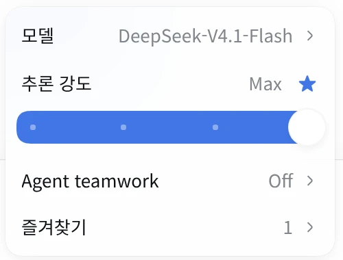

# Model Picker · 모델 피커

DSH Web 입력창의 공식 모델 메뉴에서 추론 강도 행을 단계형 슬라이더로 바꾸고, 모델과 추론 강도 조합의 즐겨찾기를 추가합니다. 모델 목록, 에이전트 협업처럼 다른 플러그인이 추가하는 행, 입력창의 모델 버튼은 공식 구현을 그대로 사용합니다. DUN Harness의 추론 강도 슬라이더를 백포트했습니다.

위 이미지는 DSH `0.2.3-alpha.2` Web의 검증 프로필에서 캡처했습니다. 표시된 모델명과 추론 단계는 예시이며, 실제 목록은 연결한 제공자가 결정합니다.

## 사용 방법

1. DSH 플러그인 설치 화면에서 `@dungsil/dsh-plugin-ui-model-picker`를 설치하고 활성화합니다.
2. 입력창의 모델 버튼을 눌러 메뉴를 엽니다. 추론 강도 슬라이더를 원하는 단계로 움직인 뒤 놓으면 바로 적용되며 메뉴는 열린 상태로 남습니다. 방향키와 Home/End 키도 사용할 수 있고, 키를 놓으면 적용됩니다.
3. 모델을 바꾸려면 메뉴의 모델 행을 눌러 공식 모델 목록에서 선택합니다.
4. 슬라이더 옆의 별 아이콘을 누르면 현재 모델과 슬라이더의 추론 강도 조합을 즐겨찾기에 추가하거나 제거합니다. 메뉴의 즐겨찾기 행을 누르면 저장한 조합이 순서대로 표시되며, 행을 눌러 바로 적용할 수 있습니다.
5. `모델 피커 열기` 단축키(`Alt + P`)는 모델 메뉴를 엽니다. `다음 즐겨찾기 모델로 전환` 단축키는 저장한 순서대로 다음 즐겨찾기를 적용합니다. Desktop의 기본 키는 `Alt + Shift + P`이며, Web은 이 조합을 기본 키로 허용하지 않으므로 DSH 단축키 설정에서 직접 지정해야 합니다.

## 동작과 호환성

- DSH `0.2.2-rc.2` 이상 `0.3.0` 미만의 Web UI를 지원합니다. 기본 `ui-model-selection` 기능이 활성화되어 있어야 합니다. 모델 메뉴의 옵션 슬롯은 `0.2.2-rc.2`부터 제공되므로 그 이전 버전에서는 동작하지 않습니다.
- 즐겨찾기 행과 목록 창은 공식 모델 메뉴가 플러그인 상세 창을 지원하는 DSH `0.2.3` 이상에서만 표시됩니다. `0.2.3` 미만에서는 별 아이콘이 추론 강도 슬라이더에 붙어 있으므로, 추론 강도를 지원하는 모델에서만 즐겨찾기를 추가하거나 제거할 수 있습니다. 저장한 즐겨찾기는 전환 단축키로 사용합니다.
- 공식 모델 메뉴의 `conversation.input.model.options` 슬롯 맨 앞에 슬라이더를 추가하고, 슬라이더가 표시되는 동안에만 공식 추론 강도 행을 숨깁니다. 선택할 추론 단계가 없어 슬라이더를 그리지 않으면 공식 행이 그대로 남습니다. 플러그인을 제거하면 공식 추론 강도 행이 그대로 돌아옵니다.
- 공용 모델 디렉터리와 선택 API를 그대로 사용하므로 `/model` 명령과 선택 상태를 공유합니다. 별도 모델 설정을 저장하거나 API 키를 다루지 않습니다.
- 모델이 기본 추론 강도를 선언하지 않으면 슬라이더 맨 앞에 `기본값` 단계가 추가되며, 이 단계는 강도를 지정하지 않은 선택을 적용합니다. 추론을 지원하지 않는 모델에는 슬라이더를 표시하지 않습니다.
- 드래그 중에는 표시만 바뀌고 조작을 마칠 때 한 번 저장합니다. 조작 중 Escape나 포커스 이탈로 취소하면 저장하지 않으며, 이미 확정한 단계는 저장이 끝나기 전에 포커스를 옮겨도 그대로 표시됩니다. 저장에 실패하면 슬라이더를 원래 단계로 되돌리고 메뉴의 오류 알림을 표시합니다.
- 즐겨찾기는 제공자·모델·추론 강도의 순서 있는 목록으로 현재 브라우저 프로필의 `localStorage`에 저장되며, 다른 탭의 변경도 반영합니다. 현재 카탈로그에 없는 모델이나 그 모델이 지원하지 않는 추론 강도는 비활성으로 표시하고 전환에서 건너뜁니다. 사용 가능한 즐겨찾기가 두 개 미만이거나 입력창이 잠겼거나 모델을 변경하는 중이면 전환하지 않습니다.
- 새 세션은 마지막으로 사용한 모델과 추론 강도를 이어받습니다.
- 한국어·영어·중국어(간체) 등 9개 언어와 DSH 테마 색상을 따릅니다.
