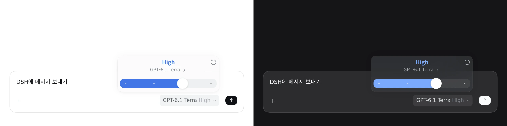

# Model Picker · 모델 피커

DSH Web 입력창에서 모델과 추론 강도를 선택합니다. 하나의 선택 버튼을 누르면 추론 강도 팝오버가 먼저 열리며, 팝오버 안의 모델명을 눌러 모델 목록으로 이동합니다.

위 이미지는 최신 빌드의 실제 플러그인 컴포넌트에 예시 모델 목록과 DSH `0.2.1-rc.5`의 공식 테마·공통 컴포넌트를 제공한 독립 검증 화면을 각각 캡처해, 좌측 라이트·우측 다크 모드의 전체 화면을 나란히 이어 붙였습니다. 표시된 모델명과 추론 단계는 예시이며, 실제 목록은 연결한 제공자가 결정합니다.

## 사용 방법

1. DSH 플러그인 설치 화면에서 `@dungsil/dsh-plugin-ui-model-picker`를 설치하고 활성화합니다.
2. 입력창 오른쪽 선택 버튼을 눌러 추론 강도 슬라이더를 엽니다. 방향키와 Home/End 키도 사용할 수 있습니다.
3. 모델을 바꾸려면 팝오버 상단의 모델명 부분을 누르고 제공자별 모델을 선택합니다. 오른쪽 위 재설정 아이콘은 기본 추론 강도를 복원합니다.

## 동작과 호환성

- DSH `0.2.1-rc.5` 이상 `0.3.0` 미만의 Web UI를 지원합니다. 기본 `ui-model-selection` 기능이 활성화되어 있어야 합니다.
- 공용 모델 디렉터리와 선택 API를 그대로 사용하므로 `/model` 명령과 선택 상태를 공유합니다. 별도 모델 설정을 저장하거나 API 키를 다루지 않습니다.
- 실제 제공자 목록과 모델별 추론 메타데이터만 사용합니다. 별도 모델 목록, Fast 모드, 고정 추론 단계는 추가하지 않습니다. 추론을 지원하지 않는 모델에는 슬라이더를 표시하지 않으며, 팝오버 안에서 모델은 계속 바꿀 수 있습니다.
- 다른 모델로 바꾸면 새 모델의 기본 추론 강도를 사용합니다. 기본값 재설정은 별도 강도 지정을 해제합니다.
- Escape, 바깥 클릭, 스크롤, 창 크기 변경으로 메뉴를 닫습니다. 메뉴의 방향키와 Tab 탐색을 지원합니다. 한국어·영어·중국어(간체)와 DSH 테마 색상을 따릅니다.
- 기본 모델 슬롯만 우선순위로 대체합니다. 제거하면 기본 선택 UI가 돌아오며 모델 선택은 유지됩니다. 같은 슬롯을 대체하는 다른 플러그인과는 함께 사용하지 마세요.

DSH가 제공하는 옵션과 플랫폼 글꼴에 따라 세부 모양은 다를 수 있습니다.
