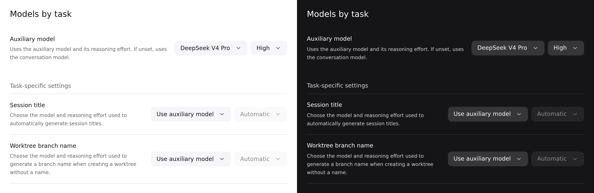

# @dungsil/dsh-plugin-ui-model-settings

DSH 설정에 **상황별 모델** 페이지를 추가하는 UI 플러그인입니다. 모델과 추론 수준 조회·저장은 [`@dungsil/dsh-plugin-model-settings`](../model-settings)가 담당하며, UI 설치 시 기능 플러그인도 함께 설치·활성화합니다.

위 이미지는 최신 빌드의 실제 플러그인 컴포넌트에 예시 모델·설정 응답과 공식 DSH 테마·UI primitives를 제공한 독립 브라우저 화면을 각각 캡처해 좌측 라이트·우측 다크 모드의 전체 화면을 나란히 이어 붙였습니다. 실제 DSH 세션 화면은 아니며, 표시된 모델과 추론 수준은 예시입니다.

## 사용 방법

1. DSH의 플러그인 설치 화면에서 `@dungsil/dsh-plugin-ui-model-settings`를 설치합니다.
2. **설정 → 상황별 모델 → 세션 제목**에서 제공자와 모델을 선택합니다.
3. **추론 수준**에서 모델이 지원하는 수준을 선택합니다. **자동 (지원하는 최저 수준)**은 기존 제목 생성 동작을 유지합니다. 추론 수준 설정을 제공하지 않는 모델에서는 선택란이 비활성화됩니다.
4. 모델과 추론 수준을 변경하면 즉시 자동으로 저장합니다. **대화 모델 따르기**를 선택하면 별도 모델 지정과 추론 수준 지정을 해제합니다.
5. 각 항목 오른쪽의 펼침 버튼으로 **지침**을 열면 기본 프롬프트 원문이 표시됩니다. 직접 수정한 뒤 **저장**합니다. 내용을 비우고 저장하면 기본 프롬프트를 복원합니다.

수정한 프롬프트는 기본 작업 프롬프트를 대체하며 다음 호출부터 적용합니다. 세션 제목·워크트리 브랜치 이름·윤문별로 따로 저장하고 모델을 바꿔도 유지합니다. 윤문의 `{{skill}}`과 `{{resources}}`는 실행할 스킬과 해당 스킬의 내장 자료로 바뀝니다. 보조 모델에는 고유한 기본 프롬프트가 없으므로 공통 추가 지침을 입력합니다. **보조 모델 따르기**를 선택한 작업의 프롬프트 뒤에 보조 모델 지침을 추가하며, 보조 모델을 지정하지 않아도 이 상속은 유지합니다. 일반 대화에는 영향을 주지 않습니다.

설정 화면을 열면 저장된 값을 자동으로 불러옵니다. 선택한 모델은 활성 프로필에서 다음 제목 생성부터 사용하며 기존 제목과 대화 모델은 바뀌지 않습니다. 저장 실패나 다른 창의 변경을 감지하면 오류를 표시하고 저장된 값을 다시 불러옵니다. 다시 불러오지 못하면 연결을 확인한 뒤 설정 화면을 다시 엽니다.

**Git Worktree UI**가 활성화되어 있으면 **워크트리 브랜치 이름** 항목도 표시합니다. 모델과 지원하는 추론 수준을 제목 설정과 별도로 저장하며, **자동 (모델 기본값)**은 워크트리의 기존 동작을 유지합니다. 이 항목에서 선택한 모델은 이름을 비운 워크트리 생성 요청의 브랜치 이름만 정합니다. 이름을 직접 입력하면 모델을 호출하지 않습니다. **대화 모델 따르기**로 모델·추론 수준 지정을 해제할 수 있습니다.

**윤문** 플러그인이 활성화되어 있으면 **윤문** 항목도 표시합니다. 모델과 추론 수준을 지정하면 다음 윤문 도구 호출부터 글다듬기·진단만 별도 모델로 실행하며 대화 모델은 유지합니다. **자동 (모델 기본값)**은 선택한 모델의 기본 추론 수준을 사용합니다. **보조 모델 따르기**는 공통 보조 모델을 사용하고, **대화 모델 따르기**는 대화 모델로 별도 호출합니다. 제목 생성기나 Git Worktree UI가 없어도 윤문 설정을 사용할 수 있습니다.

## 동작과 호환성

- DSH `0.2.1-rc.5` 이상 `0.3.0` 미만과 웹 설정 UI를 지원합니다.
- 지원하는 제목 생성기가 없거나 2개 이상이 동시에 활성화되어 있으면 제목 모델 저장을 제공하지 않습니다. 워크트리 모델은 제목 생성기 없이도 설정할 수 있으며, 활성 Git Worktree UI가 하나일 때만 표시합니다.
- 기능 플러그인의 소유자 전용 API만 호출하며, 자체 설정 저장소나 모델 요청 처리는 포함하지 않습니다.
- UI를 제거해도 제목 생성기에 저장한 모델 설정은 유지됩니다. 제거 전에 **대화 모델 따르기**로 저장하면 별도 모델 지정을 해제할 수 있습니다.

기존 통합 `model-settings` 플러그인 사용자는 이 UI 플러그인을 추가로 설치하면 기존 설정 화면을 계속 사용할 수 있습니다.
