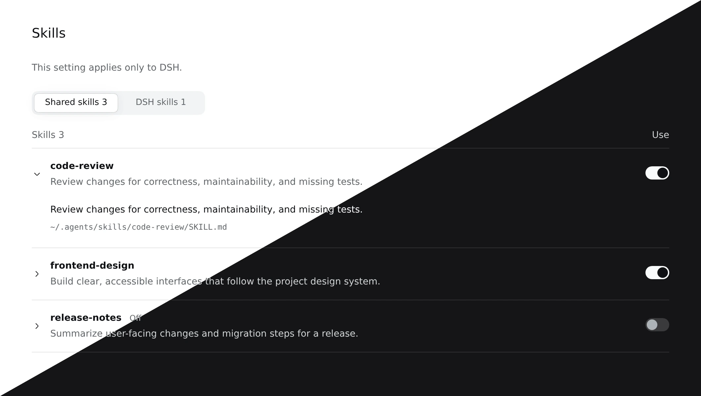

# Skills Settings · 스킬 설정

DSH Web 설정에서 로드된 사용자 스킬을 확인하고 DSH에서의 사용 여부를 설정합니다.

위 이미지는 최신 빌드의 실제 플러그인 컴포넌트에 예시 스킬 목록·설정 응답과 공식 DSH 테마·UI primitives를 제공한 독립 브라우저 화면을 각각 캡처해 합성했습니다. 실제 DSH 세션 화면은 아니며, 스킬 이름·설명·경로와 사용 상태는 예시입니다.

## 사용 방법

1. DSH 플러그인 설치 화면에서 `@dungsil/dsh-plugin-ui-setting-skills`를 설치하고 활성화합니다.
2. **설정 → 스킬**을 열고 **공용 스킬** 또는 **DSH 스킬** 탭을 선택합니다.
3. 스킬을 펼쳐 설명과 파일 경로를 확인합니다. 오른쪽 스위치로 사용 여부를 변경하면 자동 저장합니다. 이 설정은 DSH에만 적용되며 스킬 파일은 수정하지 않습니다.

## 동작과 호환성

- DSH `0.2.1-rc.5` 이상 `0.3.0` 미만의 Web UI를 지원합니다. 한국어·영어·중국어(간체)와 DSH 테마를 따릅니다.
- 공용 에이전트 및 DSH 사용자 스킬 경로에서 발견한 목록을 표시합니다. 프로젝트 스킬을 편집하거나 새 스킬을 만드는 화면은 아닙니다.
- 사고 과정 번역 서비스가 연결되어 있으면 스킬을 펼칠 때 설명을 해당 서비스로 자동 전송해 번역하고 캐시에 저장합니다. 원문으로 전환할 수 있습니다. 번역 서비스가 없으면 원문만 표시합니다.
- 저장 오류가 나타나면 설정 항목을 닫았다가 다시 열어 저장 상태를 확인한 뒤 다시 시도하세요.
