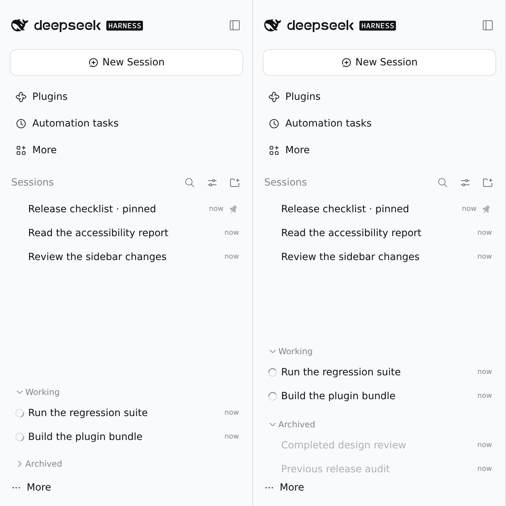
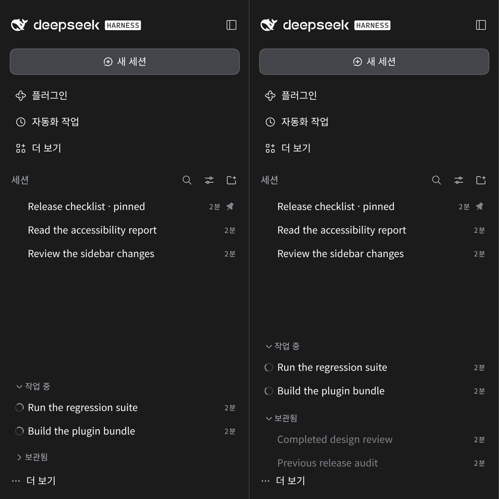

[한국어](./README.md) | [English](./README.en.md) | [简体中文](./README.zh.md) | [日本語](./README.ja.md) | [Español](./README.es.md) | [Français](./README.fr.md) | **Deutsch** | [Português](./README.pt.md) | [Русский](./README.ru.md)

# Sidebar Inbox · Seitenleisten-Posteingang

`@dungsil/dsh-plugin-ui-sidebar-inbox`

Das Plugin ordnet die Sitzungsliste in der DSH-Seitenleiste **nach Status**, ähnlich wie T3 Code Nightly. Sitzungen, die auf Ihre Antwort warten, rücken nach oben; laufende und archivierte Sitzungen sammeln sich unten. Das Aussehen der Seitenleiste und die vorhandenen Sitzungszeilen bleiben unverändert.

## Vorschau

**Hell · Englisch**: Links ist Archived eingeklappt, rechts ausgeklappt.



**Dunkel · Koreanisch**: Dieselben Beispielsitzungen im Vergleich von 보관됨 (Archived) eingeklappt und ausgeklappt.



## Verwendung

1. Aktivieren Sie **Sidebar Inbox / Seitenleisten-Posteingang** in der Plugin-Verwaltung von DSH.
2. Bei der ersten Aktivierung werden die Ansichtsoptionen automatisch auf **Gruppieren nach: In einer Liste** und **Bestellen nach: Agentenaktivität** gesetzt. Der Sitzungsfilter bleibt unverändert.
3. Um es später wieder einzuschalten, wählen Sie dieselben beiden Einträge unter **Optionen anzeigen** in der Seitenleiste.
4. Um es nicht mehr zu verwenden, stellen Sie **Bestellen nach** auf **Handbuch** (manuelle Sortierung) oder **Zuletzt aktualisiert** um, oder wählen Sie **Agentenaktivität** erneut. Bei erneuter Auswahl kehrt die Liste zu der Sortierung zurück, die Sie vor dem Einschalten von Agentenaktivität verwendet haben.

## Platzierung der Sitzungen

| Bereich  | Enthaltene Sitzungen                                                                                                               |
| -------- | ---------------------------------------------------------------------------------------------------------------------------------- |
| Pinned   | In DSH angeheftete Sitzungen. Sie bleiben hier, auch wenn sie laufen oder auf eine Antwort warten.                                 |
| Inbox    | Sitzungen, die eine Antwortprüfung, Genehmigung, Planprüfung oder Benutzereingabe benötigen, sowie noch nicht geöffnete Sitzungen. |
| Working  | Sitzungen, in denen ein Agent oder Subagent läuft. Sie wechseln in Inbox, sobald eine Anfrage entsteht.                            |
| Archived | In DSH archivierte Sitzungen. Sie bleiben hier, unabhängig davon, ob sie angeheftet sind oder laufen.                              |

- Innerhalb jedes Bereichs stehen die zuletzt aktualisierten Sitzungen zuerst. Eine leere neue Sitzung bleibt wie in DSH ganz oben.
- Diese Platzierung gilt **nur, wenn Gruppieren nach auf In einer Liste steht**. Beim Wechsel zu `WorkSpace` oder `Arbeitsbereichsbaum` wird die Sortierung nach Agentenaktivität aufgehoben und die Standardanzeige von DSH wiederhergestellt.

## Bildschirmaufbau

Die Liste der Seitenleiste ist in eine obere Liste und einen unteren Bereich geteilt, die unabhängig voneinander scrollen.

- **Obere Liste**: Zeigt Pinned und Inbox ohne Überschriften.
- **Unterer Bereich**: Working und Archived teilen sich einen Scrollbereich. Ihre Überschriften und Sitzungen zusammen nehmen höchstens 50 % der Höhe der Seitenleistenliste ein.
- **Aus- und Einklappen**: Zu Beginn ist Working ausgeklappt und Archived eingeklappt. Klicken Sie auf die Überschrift eines Bereichs oder aktivieren Sie sie per Tastatur, um ihn aus- oder einzuklappen. Dieser Zustand wird nicht gespeichert; nach dem Neuladen gilt wieder der Ausgangszustand.
- **Wann Archived einklappbar ist**: Nur wenn der Sitzungsfilter `Alle Gespräche (archiviert anzeigen)` ist. Beim Filter `Nur archiviert` bilden die archivierten Sitzungen die gesamte Liste und werden daher immer ausgeklappt angezeigt.

## Archivierung

Ob eine Sitzung archiviert ist, verwaltet DSH. Archivieren und Dearchivieren erfolgen über das `⋯`-Menü der Sitzung; dieses Plugin speichert oder ändert den Archivstatus nie.

- Archivierte Sitzungen lassen sich jederzeit aus dem unteren Bereich wiederherstellen.
- Läuft eine Sitzung oder wartet sie auf Ihre Antwort, stoppt DSH ihre Arbeit vor dem Archivieren.

## Sprachen

Listenüberschriften und Menüeinträge folgen der Sprache der DSH-Oberfläche. In der deutschen Oberfläche heißt der Sortiereintrag `Agentenaktivität`, die Bereichsüberschriften heißen `In Arbeit` und `Archiviert`. Das Plugin bringt seine eigenen Übersetzungen mit; ein separates Sprachpaket ist nicht nötig.

## Detailverhalten

### Sortierauswahl beibehalten

- Die automatische Einstellung wird **nur einmal, bei der ersten Aktivierung** einer Neuinstallation ohne frühere Sortierdaten angewendet. Danach bleiben Ihre Ansichtsoptionen auch nach Neuladen oder erneuter Aktivierung erhalten.
- Ist der Browserspeicher nicht verfügbar, wird die automatische Einstellung nicht angewendet.
- Der gewählte Sortierwert (`agent-activity`) wird im gemeinsamen Workspace-Ansichtsspeicher von DSH gespeichert und bleibt daher nach dem Neuladen erhalten.
- Beim Deaktivieren des Plugins kehrt die Liste zur zuvor verwendeten Sortierung zurück. Wirkt die Reihenfolge falsch, wählen Sie in den Ansichtsoptionen einmal **Handbuch** oder **Zuletzt aktualisiert**.

### Verhältnis zur manuellen Sortierung

Wenn Sie eine Sitzungszeile ziehen, wechselt DSH zur manuellen Sortierung, wodurch die Sortierung nach Agentenaktivität aufgehoben wird. Eine manuelle Anordnung, die Sie vor dem Einschalten von Agentenaktivität per Ziehen erstellt haben, wird nicht wiederhergestellt. Dies folgt den Regeln von DSH für Sortieränderungen.

### Wiederverwendung vorhandener DSH-Funktionen

- Sitzungszeilen, Suche, Menüs, Auswahl, Anheften und Archivfilter verwenden die vorhandenen DSH-Funktionen.
- Das Plugin aktualisiert die Listenreihenfolge von DSH, statt nur per CSS umzusortieren; so stimmt die Bildschirmreihenfolge mit der DOM-Reihenfolge (der Tastaturnavigation) überein.
- Die Scrollleisten übernehmen Breite, Farbe und Hover-Stil der Standard-Scrollleiste von DSH.

### Animation

| Aktion              | Dauer |
| ------------------- | ----- |
| Working ausklappen  | 320ms |
| Archived ausklappen | 480ms |
| Einklappen          | 260ms |

Ist die Betriebssystemeinstellung zum Reduzieren von Bewegung (`prefers-reduced-motion`) aktiv, werden Änderungen sofort ohne Animation übernommen.

### Hinweise zur Kompatibilität

Das Ansichtsoptionen-Menü von DSH `0.2.x` hat keinen Erweiterungsslot für Plugins. Daher hängt dieses Plugin von den folgenden internen Strukturen ab und braucht ein Kompatibilitätsupdate, wenn DSH sie ändert.

- Es fügt den Sortiereintrag direkt in das DOM des Ansichtsoptionen-Menüs ein.
- Es verwendet den gemeinsamen Workspace-Ansichtsspeicher und das Attribut `data-row-key` der Zeilen.
- Es ersetzt die Standardzeilen nie und verschiebt sie nicht in ein anderes DOM-Elternelement, sondern trennt obere Liste und unteren Bereich mit Shadow-DOM-Slots. Nach dem Deaktivieren stellt der Standardslot die ursprüngliche Liste wieder her.

## Entwicklung

```bash
pnpm --filter @dungsil/dsh-plugin-ui-sidebar-inbox build
pnpm --filter @dungsil/dsh-plugin-ui-sidebar-inbox typecheck
pnpm --filter @dungsil/dsh-plugin-ui-sidebar-inbox test
```

Die automatisierten Tests prüfen folgendes Verhalten.

- Eine Neuinstallation wendet die Standardsortierung an und behält danach die Auswahl des Benutzers bei.
- Der Sortiereintrag wird mit korrekter Tastaturreihenfolge und Auswahlmarkierung ins Menü eingefügt. Bei einer anderen Gruppierung wird der Eintrag deaktiviert und die Sortierung automatisch aufgehoben.
- In einer Liste werden Sitzungen nach Status platziert, archivierte Sitzungen nach unten gesetzt und je nach Archivfilter unterschiedlich angezeigt.
- Working und Archived starten ausgeklappt bzw. eingeklappt und lassen sich über ihre Überschriften umschalten; Dearchivieren wird übernommen; Überschriften aktualisieren sich beim Sprachwechsel der Oberfläche.
- Das Aufheben der Sortierung stellt die vorherige Reihenfolge wieder her.
