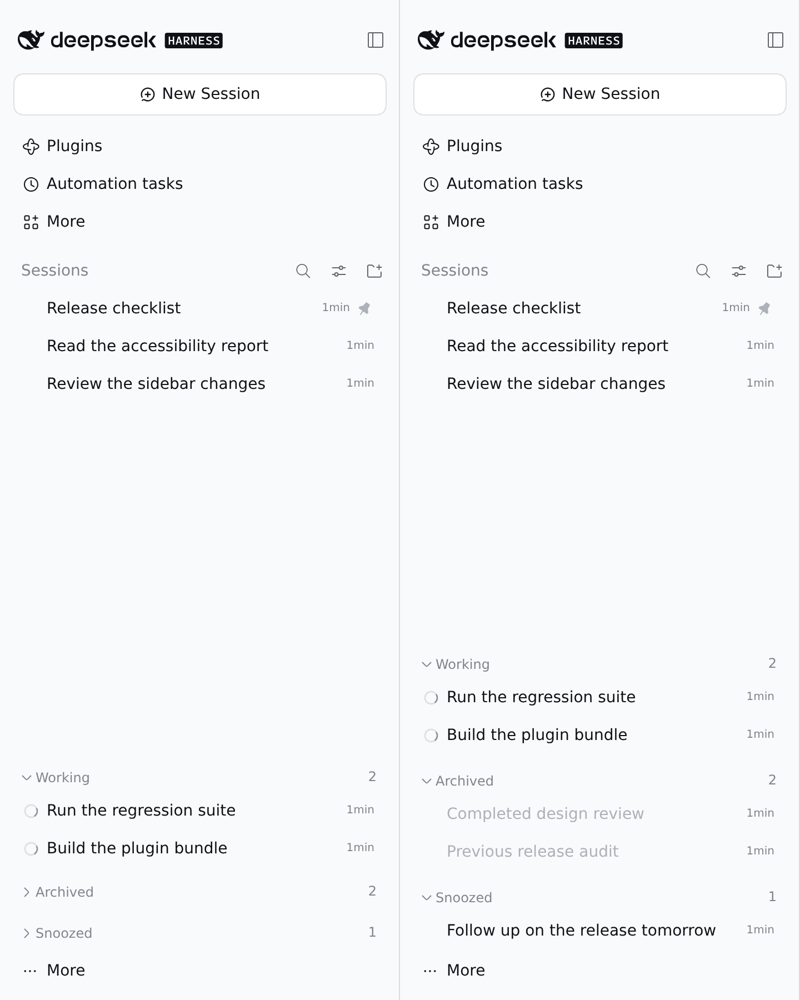
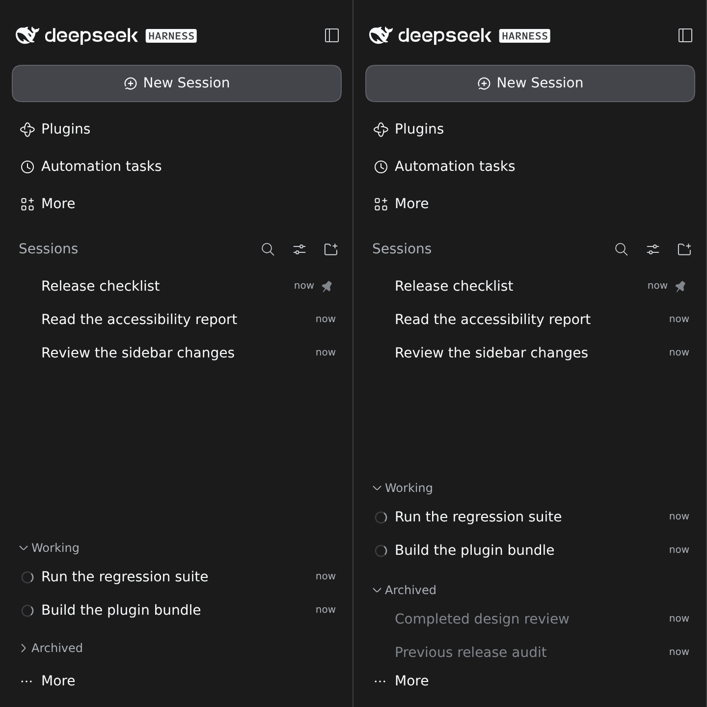

[한국어](./README.md) | **English** | [简体中文](./README.zh.md) | [日本語](./README.ja.md) | [Español](./README.es.md) | [Français](./README.fr.md) | [Deutsch](./README.de.md) | [Português](./README.pt.md) | [Русский](./README.ru.md)

# Sidebar Inbox

`@dungsil/dsh-plugin-ui-sidebar-inbox`

Sidebar Inbox organizes the DSH sidebar session list **by state**, like T3 Code Nightly. Sessions that need your response move to the top, while running and archived sessions gather at the bottom. The existing sidebar look and session rows stay unchanged.

## Preview

**Light**: Archived and Snoozed are collapsed on the left and expanded on the right. Section headings show session counts.



**Dark**: The same sample sessions, comparing Archived and Snoozed collapsed and expanded.



## Usage

1. Enable **Sidebar Inbox** in the DSH plugin management screen.
2. On first activation, the view options are set automatically to **Group by: In one list** and **Order by: Agent activity**. The session filter is not changed.
3. To turn it back on later, select the same two items in the sidebar's **View options**.
4. To stop using it, switch **Order by** to **Manual** or **Last updated**, or select **Agent activity** again. Selecting it again returns to the order you used before turning on Agent activity.

## Session placement

| Section  | Sessions included                                                                                       |
| -------- | ------------------------------------------------------------------------------------------------------- |
| Pinned   | Sessions pinned in DSH. They stay here even while running or waiting for a response.                    |
| Inbox    | Sessions that need a response check, approval, plan review, or user input, and sessions not yet opened. |
| Working  | Sessions where an agent or subagent is running. They move to Inbox when a request appears.              |
| Archived | Sessions archived in DSH. They stay here regardless of whether they are pinned or running.              |

- Within each section, the most recently updated sessions come first. A blank new session stays at the top, as in default DSH.
- This placement applies **only when Group by is In one list**. Switching to `WorkSpace` or `Workspace Tree` releases the Agent activity order and returns to the default DSH display.

## Layout

The sidebar list is split into a top list and a bottom area, and each scrolls independently.

- **Top list**: Shows Pinned and Inbox without headings.
- **Bottom area**: Working and Archived share one scroll area. Their headings and sessions together never take more than 50% of the sidebar list height.
- **Expanding and collapsing**: Working starts expanded and Archived starts collapsed. Click a section heading or activate it with the keyboard to expand or collapse it. This state is not saved, so a reload restores the initial state.
- **When Archived can collapse**: Archived can be collapsed only when the session filter is `All conversations (show archived)`. With the `Archived only` filter, archived sessions are the entire list, so they always stay expanded.

## Archiving

DSH manages whether a session is archived. Archive and unarchive a session from its `⋯` menu; this plugin never stores or changes the archive state.

- You can restore an archived session from the bottom area at any time.
- If a session is running or waiting for your response, DSH stops its work before archiving it.

## Languages

List headings and menu items follow the DSH UI language. In the English UI, the sort item reads `Agent activity` and the section headings read `Working` and `Archived`. The plugin ships its own translations for these labels.

## Details

### Keeping your sort choice

- The automatic setup is applied **only once, on first activation** of a new installation with no previous sort record. After that, reloading or re-enabling the plugin keeps the view options you chose.
- If browser storage is unavailable, the automatic setup is not applied.
- The selected sort value (`agent-activity`) is saved in DSH's shared Workspace view store, so it survives reloads.
- Disabling the plugin returns to the sort order you used before. If the order looks wrong, select **Manual** or **Last updated** once in the view options.

### Interaction with manual sorting

Dragging a session row makes DSH switch to manual sorting, which releases the Agent activity order. Any manual arrangement you dragged before turning on Agent activity is not restored. This follows DSH's own rules for changing the sort order.

### Reusing existing DSH features

- Session rows, search, menus, selection, pinning, and the archive filter all use DSH's existing features.
- The plugin updates DSH's list order instead of reordering with CSS only, so the on-screen order matches the DOM order (the keyboard navigation order).
- Scrollbars follow the thickness, color, and hover style of the default DSH scrollbar.

### Animation

| Action          | Duration |
| --------------- | -------- |
| Expand Working  | 320ms    |
| Expand Archived | 480ms    |
| Collapse        | 260ms    |

When the operating system's reduce motion setting (`prefers-reduced-motion`) is on, changes apply immediately without animation.

### Compatibility notes

The view options menu in DSH `0.2.x` has no plugin extension slot. This plugin therefore depends on the internal structures below and needs a compatibility update if DSH changes them.

- It adds the sort item directly to the view options menu DOM.
- It uses the shared Workspace view store and the `data-row-key` attribute on rows.
- It never replaces default rows or moves them to another DOM parent; it splits the top list and bottom area with Shadow DOM slots. When disabled, the default slot restores the original list.

## Development

```bash
pnpm --filter @dungsil/dsh-plugin-ui-sidebar-inbox build
pnpm --filter @dungsil/dsh-plugin-ui-sidebar-inbox typecheck
pnpm --filter @dungsil/dsh-plugin-ui-sidebar-inbox test
```

The automated tests check the following behavior.

- A new installation applies the default sort, and later user choices are kept.
- The sort item is added to the menu with the correct keyboard order and selection mark. When Group by differs, the item is disabled and the sort is released automatically.
- In one list, sessions are placed by state, archived sessions go to the bottom, and each archive filter displays them differently.
- Working and Archived start expanded and collapsed and toggle from their headings; unarchiving is reflected; headings update when the UI language changes.
- Releasing the sort restores the previous order.
