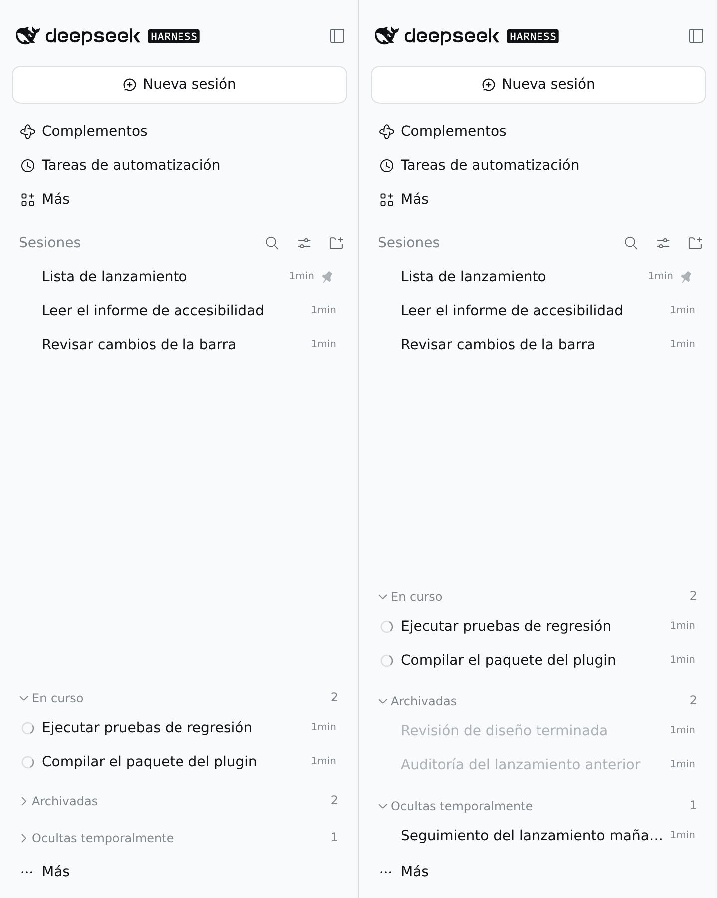
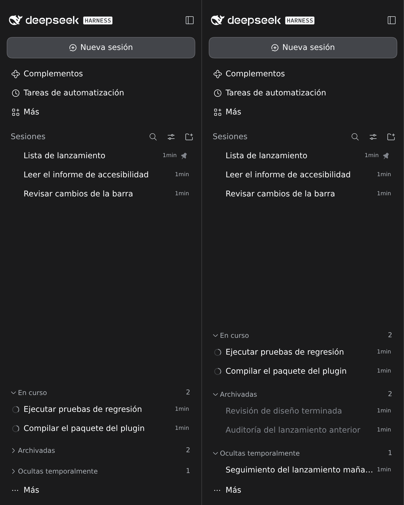

[한국어](./README.md) | [English](./README.en.md) | [简体中文](./README.zh.md) | [日本語](./README.ja.md) | **Español** | [Français](./README.fr.md) | [Deutsch](./README.de.md) | [Português](./README.pt.md) | [Русский](./README.ru.md)

# Sidebar Inbox · Bandeja de entrada lateral

`@dungsil/dsh-plugin-ui-sidebar-inbox`

Organiza la lista de sesiones de la barra lateral de DSH **por estado**, como T3 Code Nightly. Las sesiones que necesitan tu respuesta suben arriba, y las sesiones en ejecución y las archivadas se agrupan abajo. El aspecto de la barra lateral y las filas de sesión existentes no cambian.

## Vista previa

**Claro**: a la izquierda, Archivadas plegado; a la derecha, desplegado.



**Oscuro**: las mismas sesiones de ejemplo, comparando Archivadas plegado y desplegado.



## Uso

1. Activa **Sidebar Inbox / Bandeja de entrada lateral** en la pantalla de gestión de plugins de DSH.
2. En la primera activación, las opciones de vista se configuran automáticamente como **Agrupar por: en una lista** y **Ordenar por: Actividad del agente**. El filtro de sesiones no cambia.
3. Para volver a activarlo más adelante, selecciona esos dos mismos elementos en **Ver opciones** de la barra lateral.
4. Para dejar de usarlo, cambia **Ordenar por** a **manuales** o **Última actualización**, o vuelve a seleccionar **Actividad del agente**. Si lo vuelves a seleccionar, se restablece el orden que usabas antes de activar Actividad del agente.

## Ubicación de las sesiones

| Sección  | Sesiones incluidas                                                                                                                     |
| -------- | -------------------------------------------------------------------------------------------------------------------------------------- |
| Pinned   | Sesiones fijadas en DSH. Permanecen aquí aunque estén en ejecución o esperando una respuesta.                                          |
| Inbox    | Sesiones que necesitan revisar una respuesta, una aprobación, una revisión del plan o entrada del usuario, y sesiones aún no abiertas. |
| Working  | Sesiones con un agente o subagente en ejecución. Pasan a Inbox cuando aparece una solicitud.                                           |
| Archived | Sesiones archivadas en DSH. Permanecen aquí aunque estén fijadas o en ejecución.                                                       |

- Dentro de cada sección, las sesiones actualizadas más recientemente aparecen primero. Una sesión nueva vacía se mantiene arriba, igual que en DSH.
- Esta ubicación se aplica **solo cuando Agrupar por es en una lista**. Al cambiar a `Espacio de trabajo` o `Árbol del espacio de trabajo`, se desactiva el orden Actividad del agente y se vuelve a la vista predeterminada de DSH.

## Diseño de la pantalla

La lista de la barra lateral se divide en una lista superior y un área inferior, y cada una se desplaza por separado.

- **Lista superior**: muestra Pinned e Inbox sin encabezados.
- **Área inferior**: Working y Archived comparten un área de desplazamiento. Sus encabezados y sesiones juntos nunca ocupan más del 50 % de la altura de la lista de la barra lateral.
- **Desplegar y plegar**: al principio, Working está desplegado y Archived plegado. Haz clic en el encabezado de una sección o actívalo con el teclado para desplegarla o plegarla. Este estado no se guarda, así que al recargar vuelve al estado inicial.
- **Cuándo se puede plegar Archived**: solo cuando el filtro de sesiones es `Todas las conversaciones (mostrar archivadas)`. Con el filtro `Sólo archivado`, las sesiones archivadas son toda la lista, así que siempre se muestran desplegadas.

## Archivado

DSH gestiona si una sesión está archivada. Archiva y desarchiva una sesión desde su menú `⋯`; este plugin nunca guarda ni cambia el estado de archivado.

- Puedes restaurar una sesión archivada desde el área inferior en cualquier momento.
- Si una sesión está en ejecución o esperando tu respuesta, DSH detiene su trabajo antes de archivarla.

## Idiomas

Los encabezados de la lista y los elementos del menú siguen el idioma de la interfaz de DSH. En la interfaz en español, el elemento de orden se muestra como `Actividad del agente` y los encabezados de sección como `En curso` y `Archivadas`. El plugin incluye sus propias traducciones, así que no necesitas un paquete de idioma aparte.

## Comportamiento detallado

### Conservar la elección de orden

- La configuración automática se aplica **solo una vez, en la primera activación** de una instalación nueva sin registro de orden previo. Después, aunque recargues o vuelvas a activar el plugin, se conservan las opciones de vista que elegiste.
- Si el almacenamiento del navegador no está disponible, la configuración automática no se aplica.
- El valor de orden seleccionado (`agent-activity`) se guarda en el almacén de vista compartido de Workspace de DSH, por lo que se conserva tras recargar.
- Al desactivar el plugin, se vuelve al orden que usabas antes. Si el orden parece incorrecto, selecciona una vez **manuales** o **Última actualización** en las opciones de vista.

### Relación con el orden manual

Al arrastrar una fila de sesión, DSH cambia al orden manual, lo que desactiva el orden Actividad del agente. La disposición manual que hubieras arrastrado antes de activar Actividad del agente no se restaura. Esto sigue las propias reglas de DSH para cambiar el orden.

### Reutilización de funciones de DSH

- Las filas de sesión, la búsqueda, los menús, la selección, la fijación y el filtro de archivado usan las funciones existentes de DSH.
- El plugin actualiza el orden de la lista de DSH en lugar de reordenar solo con CSS, por lo que el orden en pantalla coincide con el orden del DOM (el orden de navegación con el teclado).
- Las barras de desplazamiento siguen el grosor, el color y el estilo al pasar el cursor de la barra de desplazamiento predeterminada de DSH.

### Animación

| Acción             | Duración |
| ------------------ | -------- |
| Desplegar Working  | 320ms    |
| Desplegar Archived | 480ms    |
| Plegar             | 260ms    |

Si activas la opción de reducir movimiento del sistema operativo (`prefers-reduced-motion`), los cambios se aplican al instante sin animación.

### Notas de compatibilidad

El menú de opciones de vista de DSH `0.2.x` no tiene una ranura de extensión para plugins. Por eso, este plugin depende de las estructuras internas siguientes y necesita una actualización de compatibilidad si DSH las cambia.

- Añade el elemento de orden directamente al DOM del menú de opciones de vista.
- Usa el almacén de vista compartido de Workspace y el atributo `data-row-key` de las filas.
- Nunca sustituye las filas predeterminadas ni las mueve a otro elemento padre del DOM; separa la lista superior y el área inferior con ranuras de Shadow DOM. Al desactivarlo, la ranura predeterminada restaura la lista original.

## Desarrollo

```bash
pnpm --filter @dungsil/dsh-plugin-ui-sidebar-inbox build
pnpm --filter @dungsil/dsh-plugin-ui-sidebar-inbox typecheck
pnpm --filter @dungsil/dsh-plugin-ui-sidebar-inbox test
```

Las pruebas automáticas comprueban el siguiente comportamiento.

- Una instalación nueva aplica el orden predeterminado y después conserva la elección del usuario.
- El elemento de orden se añade al menú con el orden de teclado y la marca de selección correctos. Si Agrupar por es distinto, el elemento se desactiva y el orden se libera automáticamente.
- En una lista, las sesiones se colocan por estado, las archivadas van abajo y cada filtro de archivado las muestra de forma distinta.
- Working y Archived empiezan desplegado y plegado y se alternan desde sus encabezados; se refleja el desarchivado; los encabezados se actualizan al cambiar el idioma de la interfaz.
- Al liberar el orden, se restaura el orden anterior.
