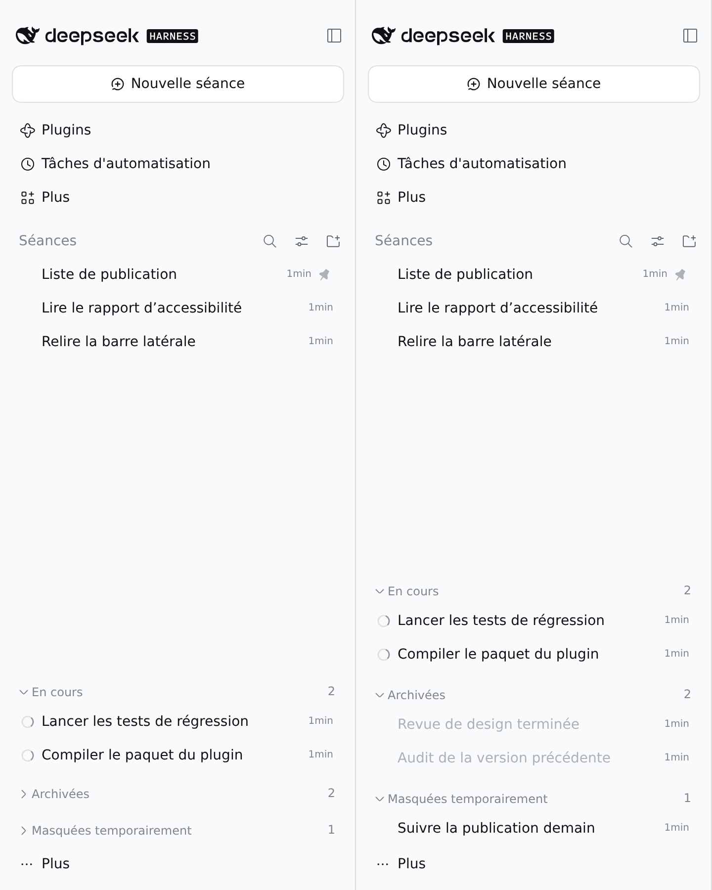
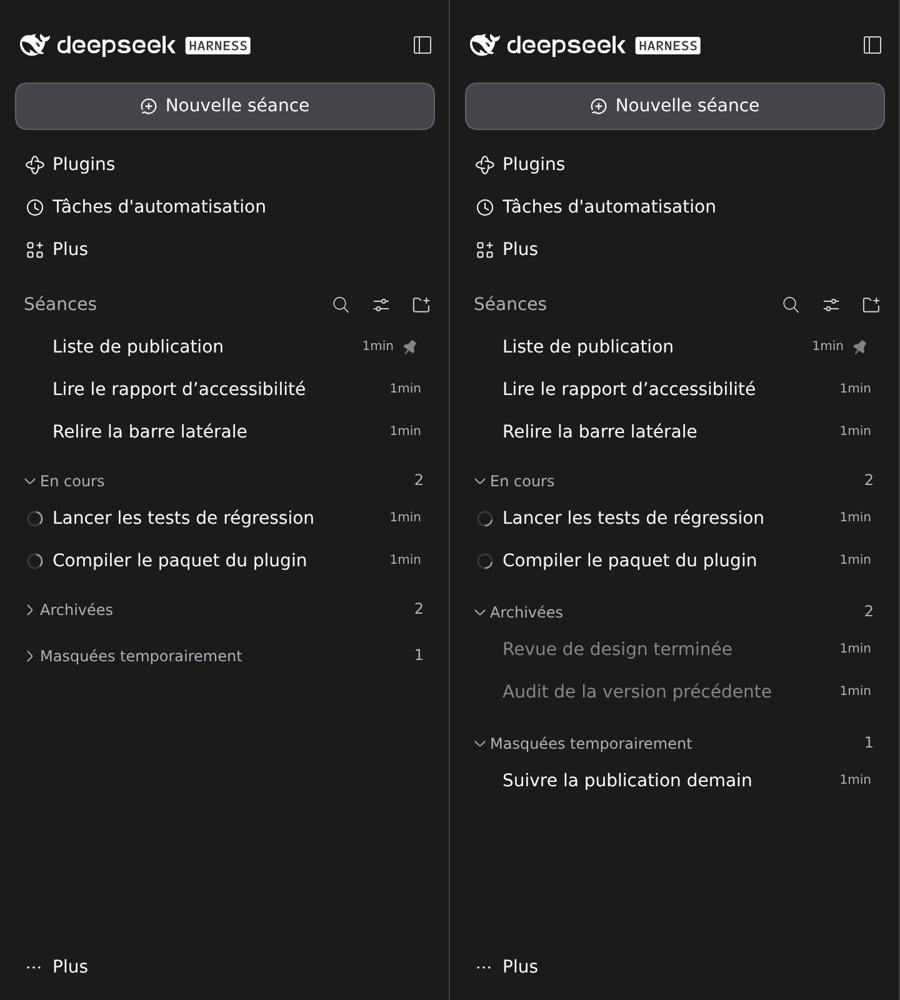

[한국어](./README.md) | [English](./README.en.md) | [简体中文](./README.zh.md) | [日本語](./README.ja.md) | [Español](./README.es.md) | **Français** | [Deutsch](./README.de.md) | [Português](./README.pt.md) | [Русский](./README.ru.md)

# Sidebar Inbox · Boîte de réception latérale

`@dungsil/dsh-plugin-ui-sidebar-inbox`

Ce plugin organise la liste des sessions de la barre latérale de DSH **par état**, comme T3 Code Nightly. Les sessions qui attendent votre réponse remontent en haut, tandis que les sessions en cours et archivées se regroupent en bas. L’apparence de la barre latérale et les lignes de session existantes restent inchangées.

## Aperçu

**Clair** : Archivées et Masquées temporairement sont repliées à gauche et dépliées à droite. Les titres indiquent le nombre de sessions.



**Sombre** : les mêmes sessions d’exemple, comparant Archivées et Masquées temporairement repliées et dépliées.



## Utilisation

1. Activez **Sidebar Inbox / Boîte de réception latérale** dans l’écran de gestion des plugins de DSH.
2. À la première activation, les options d’affichage sont réglées automatiquement sur **Regrouper par : Dans une liste** et **Commander par : Activité de l’agent**. Le filtre des sessions n’est pas modifié.
3. Pour le réactiver plus tard, sélectionnez ces deux mêmes éléments dans **Afficher les options** de la barre latérale.
4. Pour ne plus l’utiliser, passez **Commander par** à **Manuel** ou **Dernière mise à jour**, ou sélectionnez de nouveau **Activité de l’agent**. Le sélectionner de nouveau rétablit l’ordre que vous utilisiez avant d’activer Activité de l’agent.

## Placement des sessions

| Section  | Sessions incluses                                                                                                                  |
| -------- | ---------------------------------------------------------------------------------------------------------------------------------- |
| Pinned   | Sessions épinglées dans DSH. Elles restent ici même lorsqu’elles sont en cours ou attendent une réponse.                           |
| Inbox    | Sessions qui demandent de vérifier une réponse, une approbation, une revue de plan ou une saisie, et sessions pas encore ouvertes. |
| Working  | Sessions dont un agent ou un sous-agent est en cours d’exécution. Elles passent dans Inbox lorsqu’une demande apparaît.            |
| Archived | Sessions archivées dans DSH. Elles restent ici, qu’elles soient épinglées ou en cours d’exécution.                                 |

- Dans chaque section, les sessions mises à jour le plus récemment apparaissent en premier. Une nouvelle session vide reste en haut, comme dans DSH.
- Ce placement s’applique **uniquement lorsque Regrouper par vaut Dans une liste**. Passer à `Espace de travail` ou `Arborescence de l'espace de travail` désactive l’ordre Activité de l’agent et rétablit l’affichage par défaut de DSH.

## Disposition de l’écran

La liste de la barre latérale est divisée en une liste supérieure et une zone inférieure, chacune défilant séparément.

- **Liste supérieure** : affiche Pinned et Inbox sans titre.
- **Zone inférieure** : Working et Archived partagent une seule zone de défilement. Leurs titres et leurs sessions réunis n’occupent jamais plus de 50 % de la hauteur de la liste de la barre latérale.
- **Déplier et replier** : au départ, Working est déplié et Archived replié. Cliquez sur le titre d’une section ou activez-le au clavier pour la déplier ou la replier. Cet état n’est pas enregistré : un rechargement rétablit l’état initial.
- **Quand Archived peut être replié** : uniquement lorsque le filtre des sessions est `Toutes les conversations (afficher les archives)`. Avec le filtre `Archivé uniquement`, les sessions archivées forment toute la liste ; elles restent donc toujours dépliées.

## Archivage

DSH gère l’état d’archivage des sessions. Archivez et désarchivez une session depuis son menu `⋯` ; ce plugin n’enregistre ni ne modifie jamais l’état d’archivage.

- Vous pouvez restaurer une session archivée depuis la zone inférieure à tout moment.
- Si une session est en cours ou attend votre réponse, DSH arrête son travail avant de l’archiver.

## Langues

Les titres de la liste et les éléments de menu suivent la langue de l’interface de DSH. Dans l’interface en français, l’élément de tri s’affiche `Activité de l’agent` et les titres de section `En cours` et `Archivées`. Le plugin inclut ses propres traductions ; aucun pack de langue supplémentaire n’est nécessaire.

## Comportement détaillé

### Conserver le choix de tri

- La configuration automatique est appliquée **une seule fois, à la première activation** d’une nouvelle installation sans historique de tri. Ensuite, recharger ou réactiver le plugin conserve les options d’affichage que vous avez choisies.
- Si le stockage du navigateur n’est pas disponible, la configuration automatique n’est pas appliquée.
- La valeur de tri sélectionnée (`agent-activity`) est enregistrée dans le magasin de vue partagé Workspace de DSH ; elle est donc conservée après un rechargement.
- Désactiver le plugin rétablit l’ordre que vous utilisiez auparavant. Si l’ordre semble incorrect, sélectionnez une fois **Manuel** ou **Dernière mise à jour** dans les options d’affichage.

### Relation avec le tri manuel

Faire glisser une ligne de session fait passer DSH au tri manuel, ce qui désactive l’ordre Activité de l’agent. La disposition manuelle obtenue par glisser-déposer avant d’activer Activité de l’agent n’est pas restaurée. Ce comportement suit les règles de DSH pour changer l’ordre.

### Réutilisation des fonctions de DSH

- Les lignes de session, la recherche, les menus, la sélection, l’épinglage et le filtre d’archivage utilisent les fonctions existantes de DSH.
- Le plugin met à jour l’ordre de la liste de DSH au lieu de réordonner uniquement avec CSS ; l’ordre à l’écran correspond donc à l’ordre du DOM (l’ordre de navigation au clavier).
- Les barres de défilement suivent l’épaisseur, la couleur et le style de survol de la barre de défilement par défaut de DSH.

### Animation

| Action           | Durée |
| ---------------- | ----- |
| Déplier Working  | 320ms |
| Déplier Archived | 480ms |
| Replier          | 260ms |

Lorsque le réglage de réduction des animations du système d’exploitation (`prefers-reduced-motion`) est activé, les changements s’appliquent immédiatement, sans animation.

### Notes de compatibilité

Le menu des options d’affichage de DSH `0.2.x` n’a pas d’emplacement d’extension pour les plugins. Ce plugin dépend donc des structures internes ci-dessous et nécessite une mise à jour de compatibilité si DSH les modifie.

- Il ajoute l’élément de tri directement dans le DOM du menu des options d’affichage.
- Il utilise le magasin de vue partagé Workspace et l’attribut `data-row-key` des lignes.
- Il ne remplace jamais les lignes par défaut et ne les déplace pas vers un autre parent du DOM ; il sépare la liste supérieure et la zone inférieure avec des slots Shadow DOM. Une fois désactivé, le slot par défaut rétablit la liste d’origine.

## Développement

```bash
pnpm --filter @dungsil/dsh-plugin-ui-sidebar-inbox build
pnpm --filter @dungsil/dsh-plugin-ui-sidebar-inbox typecheck
pnpm --filter @dungsil/dsh-plugin-ui-sidebar-inbox test
```

Les tests automatisés vérifient le comportement suivant.

- Une nouvelle installation applique le tri par défaut, puis conserve le choix de l’utilisateur.
- L’élément de tri est ajouté au menu avec un ordre clavier et une marque de sélection corrects. Si Regrouper par est différent, l’élément est désactivé et le tri est libéré automatiquement.
- Dans une liste unique, les sessions sont placées par état, les sessions archivées vont en bas et chaque filtre d’archivage les affiche différemment.
- Working et Archived démarrent déplié et replié et se basculent depuis leurs titres ; le désarchivage est pris en compte ; les titres se mettent à jour lorsque la langue de l’interface change.
- Libérer le tri rétablit l’ordre précédent.
