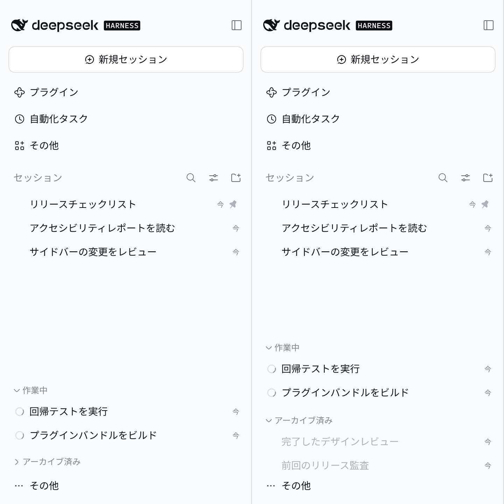
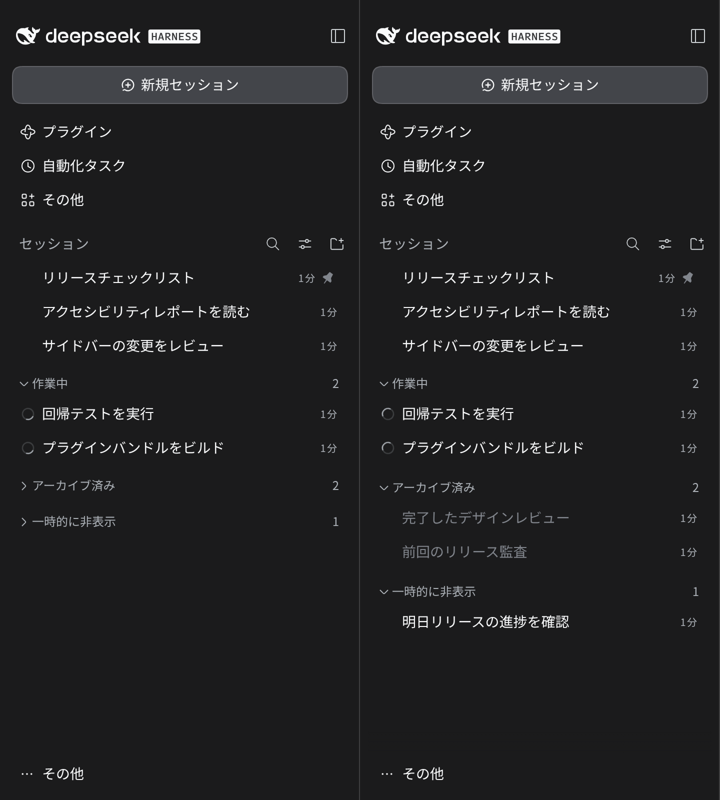

[한국어](./README.md) | [English](./README.en.md) | [简体中文](./README.zh.md) | **日本語** | [Español](./README.es.md) | [Français](./README.fr.md) | [Deutsch](./README.de.md) | [Português](./README.pt.md) | [Русский](./README.ru.md)

# Sidebar Inbox · サイドバー受信箱

`@dungsil/dsh-plugin-ui-sidebar-inbox`

DSH サイドバーのセッション一覧を、T3 Code Nightly のように**状態別**に整理します。返信が必要なセッションは上へ、実行中のセッションとアーカイブしたセッションは下へまとめます。既存のサイドバーの見た目とセッション行はそのまま維持します。

## プレビュー

**ライト**：左は アーカイブ済み を折りたたんだ状態、右は展開した状態です。



**ダーク**：同じサンプルセッションで、アーカイブ済み の折りたたみと展開を比較します。



## 使い方

1. DSH のプラグイン管理画面で **Sidebar Inbox / サイドバー受信箱** を有効にします。
2. 初めて有効にすると、表示オプションが **グループ化：1つのリスト**、**並び順：エージェントの活動** に自動で設定されます。セッションフィルターは変更しません。
3. 後で再びオンにするには、サイドバーの **表示オプション** で同じ 2 つの項目を選択します。
4. 使用をやめるには、並び順を **手動** または **最終更新** に変えるか、**エージェントの活動** をもう一度選択します。もう一度選択すると、エージェントの活動をオンにする前の並び順に戻ります。

## セッションの配置

| 領域     | 含まれるセッション                                                                                   |
| -------- | ---------------------------------------------------------------------------------------------------- |
| Pinned   | DSH でピン留めしたセッションです。実行中や返信待ちでもこの領域に置きます。                           |
| Inbox    | 返信の確認、承認、計画のレビュー、ユーザー入力が必要なセッションと、まだ開いていないセッションです。 |
| Working  | エージェントまたはサブエージェントが実行中のセッションです。要求が発生すると Inbox に移ります。      |
| Archived | DSH でアーカイブしたセッションです。ピン留めや実行状態に関係なくこの領域に置きます。                 |

- 各領域では、最近更新されたセッションを先に表示します。内容のない新しいセッションは、既存の DSH と同じく一番上に置きます。
- この配置は **グループ化が 1つのリスト のときだけ** 適用されます。`ワークスペース` や `ワークスペースツリー` に切り替えると、エージェントの活動の並び順が解除され、DSH の既定の表示に戻ります。

## 画面構成

サイドバーの一覧は上部の一覧と下部の領域に分かれ、それぞれ独立してスクロールします。

- **上部の一覧**：Pinned と Inbox を見出しなしで表示します。
- **下部の領域**：Working と Archived が 1 つのスクロール領域を共有します。見出しとセッションを合わせた高さは、サイドバー一覧の高さの 50% を超えません。
- **展開と折りたたみ**：最初は Working を展開し、Archived を折りたたんでおきます。領域の見出しをクリックするか、キーボードで操作すると展開・折りたたみできます。この状態は保存されないため、再読み込みすると最初の状態に戻ります。
- **Archived を折りたためる条件**：セッションフィルターが `すべての会話（アーカイブを表示）` のときだけ折りたためます。`アーカイブのみ` フィルターではアーカイブしたセッションが一覧全体なので、常に展開して表示します。

## アーカイブ

アーカイブするかどうかは DSH が管理します。アーカイブとアーカイブ解除はセッションの `⋯` メニューから実行し、このプラグインはアーカイブ状態を保存も変更もしません。

- アーカイブしたセッションは、下部の領域からいつでも復元できます。
- 実行中またはユーザーの返信を待っているセッションは、DSH がアーカイブする前に作業を停止します。

## 言語

一覧の見出しとメニュー項目は DSH の UI 言語に従います。日本語 UI では、並び順の項目が `エージェントの活動`、領域の見出しが `作業中` と `アーカイブ済み` と表示されます。翻訳はプラグインに含まれているため、別の言語パックは必要ありません。

## 詳細な動作

### 並び順の選択を保持する

- 自動設定は、以前の並び順の記録がない新規インストールで **初めて有効にしたときに一度だけ** 適用されます。その後は再読み込みや再有効化をしても、ユーザーが選んだ表示オプションを維持します。
- ブラウザーのストレージが使えない場合、自動設定は適用されません。
- 選択した並び順の値（`agent-activity`）は DSH の共有 Workspace 表示ストアに保存されるため、再読み込み後も維持されます。
- プラグインを無効にすると、以前使っていた並び順に戻ります。並び順がずれて見える場合は、表示オプションで **手動** または **最終更新** を一度選択します。

### 手動の並び替えとの関係

セッション行をドラッグすると DSH が手動の並び順に切り替えるため、エージェントの活動の並び順は解除されます。このとき、エージェントの活動をオンにする前にドラッグしておいた手動の配置は復元されません。これは DSH の並び順変更ルールにそのまま従った結果です。

### DSH の既存機能の再利用

- セッション行、検索、メニュー、選択、ピン留め、アーカイブフィルターは DSH の既存機能をそのまま使います。
- CSS で順序だけを変えるのではなく DSH の一覧の並び順を更新するため、画面上の順序と DOM の順序（キーボード移動の順序）が一致します。
- スクロールバーは、DSH の既定のスクロールバーの太さ、色、ホバースタイルに従います。

### アニメーション

| 動作            | 時間  |
| --------------- | ----- |
| Working の展開  | 320ms |
| Archived の展開 | 480ms |
| 折りたたみ      | 260ms |

OS の視差効果を減らす設定（`prefers-reduced-motion`）をオンにすると、アニメーションなしで即座に切り替わります。

### 互換性について

DSH `0.2.x` の表示オプションメニューには、プラグイン用の拡張スロットがありません。そのため、このプラグインは次の内部構造に依存しており、DSH がこれらの構造を変更した場合は互換性の更新が必要です。

- 並び順の項目を表示オプションメニューの DOM に直接追加します。
- 共有 Workspace 表示ストアと、行の `data-row-key` 属性を使います。
- 既定の行を置き換えたり別の DOM の親へ移動したりせず、Shadow DOM のスロットで上部の一覧と下部の領域を分けます。無効にすると、既定のスロットが元の一覧を復元します。

## 開発

```bash
pnpm --filter @dungsil/dsh-plugin-ui-sidebar-inbox build
pnpm --filter @dungsil/dsh-plugin-ui-sidebar-inbox typecheck
pnpm --filter @dungsil/dsh-plugin-ui-sidebar-inbox test
```

自動テストは次の動作を確認します。

- 新規インストールで既定の並び順を適用し、その後はユーザーの選択を維持します。
- 並び順の項目をメニューに追加し、キーボードの順序と選択表示を維持します。グループ化が異なる場合は項目を無効にし、並び順を自動で解除します。
- 1つのリストで状態別に配置し、アーカイブしたセッションを下部に置き、アーカイブフィルターごとに表示を変えます。
- Working と Archived の既定の展開・折りたたみと見出しによる切り替え、アーカイブ解除の反映、UI 言語の切り替えに伴う見出しの更新を確認します。
- 並び順を解除すると、以前の並び順に戻します。
