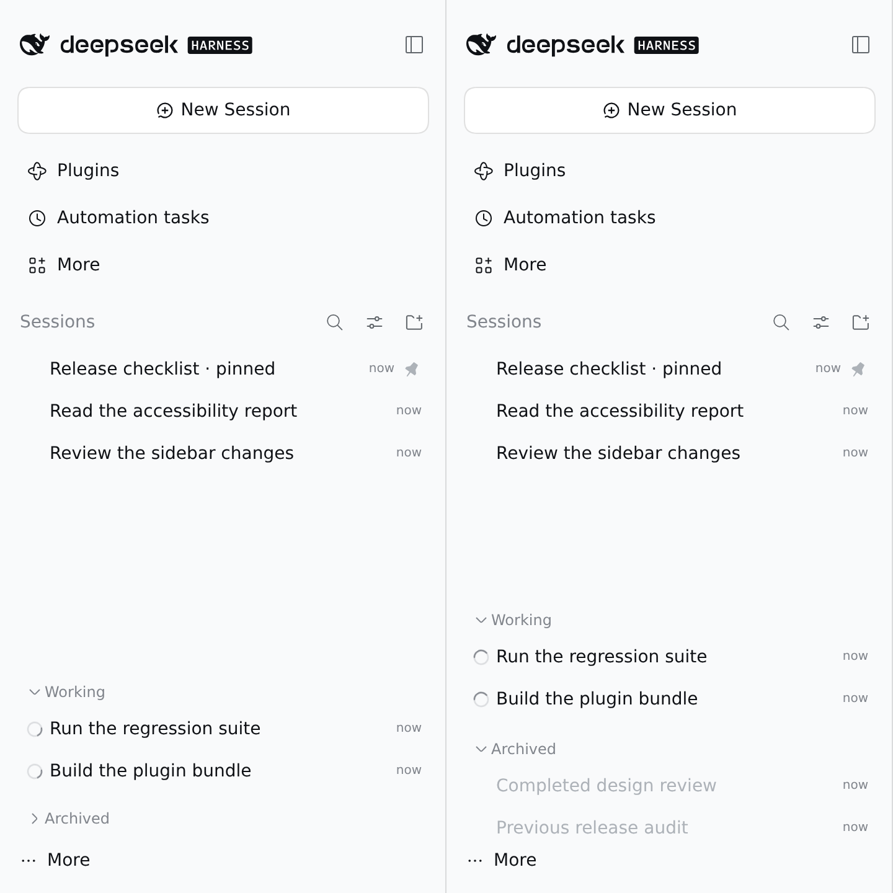

# @dungsil/dsh-plugin-ui-sidebar-inbox

DSH의 기존 사이드바 모양을 유지하면서, 프로젝트별 목록을 T3 Code Nightly처럼 상태별 목록으로 배치합니다. 설치 후 최초 활성화 시 `[그룹 기준] > [하나의 목록]`과 `[정렬 기준] > [에이전트 활동]`을 자동으로 선택합니다. 이후 사용자가 바꾼 보기 옵션은 유지합니다.

기존 `@dungsil/dsh-plugin-sidebar-inbox`를 대체하는 패키지이며, 새 이름의 첫 버전은 `0.1.0`입니다. 기존 패키지의 모든 버전은 사용 중단(deprecated) 대상입니다. 기존 패키지를 비활성화하고 새 패키지를 설치·활성화합니다. 두 패키지를 동시에 활성화하지 마세요. 기존 정렬 선택과 이전 정렬 복원 설정은 유지됩니다.



DSH `0.2.2-alpha.2`의 영어 UI에서 예시 세션으로 촬영한 화면입니다. 왼쪽은 Archived가 접힌 기본 상태이고, 오른쪽은 펼친 상태입니다.

## 배치 규칙

| 영역     | 포함되는 세션                                                                         |
| -------- | ------------------------------------------------------------------------------------- |
| Pinned   | DSH에서 고정한 세션입니다. 기존 고정을 우선합니다.                                    |
| Inbox    | 응답 확인, 승인, 계획 검토, 사용자 입력이 필요하거나 아직 열지 않은 세션입니다.       |
| Working  | 에이전트 또는 하위 에이전트가 실행 중인 세션입니다. 요청이 생기면 Inbox로 돌아옵니다. |
| Archived | DSH에서 보관한 세션입니다. 보관과 해제는 DSH의 `⋯` 메뉴에서 실행합니다.               |

각 영역에서는 최근 갱신된 세션을 먼저 표시합니다. 빈 새 세션은 기존 DSH처럼 맨 위에 둡니다.

목록 제목과 메뉴 항목은 DSH UI 언어를 따릅니다. 한국어 UI에서는 정렬 항목이 `에이전트 활동`, 영역 제목이 `작업 중`·`보관됨`으로 표시됩니다. 번역 사전은 이 플러그인이 직접 포함하므로 한국어 UI 언어 팩을 따로 설치하지 않아도 됩니다.

Pinned와 Inbox는 별도 제목 없이 위쪽 목록에 표시합니다. Working과 Archived는 펼친 영역의 전체 높이가 사이드바 표시 영역에 들어갈 때 하단에 붙어 있습니다. 높이가 표시 영역을 넘으면 하단 고정을 해제하므로 제목과 모든 세션을 목록 스크롤로 확인할 수 있습니다. 영역을 접거나 사이드바 높이를 늘려 다시 들어가면 하단 고정이 복원됩니다. 기본값은 Working을 펼치고 Archived를 접은 상태입니다. 두 제목을 누르거나 키보드로 활성화하면 각 영역이 부드럽게 펼쳐지고 접힙니다. Archived는 세션 필터가 `모든 대화 (보관된 세션 포함)`일 때만 접을 수 있습니다. `보관된 세션만` 필터에서는 보관한 세션이 목록 전체이므로 접지 않고 그대로 표시합니다. 새로고침하면 기본값으로 돌아갑니다.

이 배치와 제목은 `그룹 기준`이 `하나의 목록`일 때만 적용됩니다. `작업 공간`·`작업 공간 트리` 그룹에서는 DSH 기본 표시를 따르며, 정렬을 켠 채 그룹 기준을 바꾸면 자동으로 해제됩니다.

## 사용법

1. 설치 후 최초 활성화하면 **하나의 목록 / 에이전트 활동**이 자동으로 적용됩니다. 세션 필터는 바꾸지 않습니다.
2. 나중에 다시 켜려면 사이드바의 **보기 옵션**(필터 아이콘)에서 **그룹 기준**을 **하나의 목록**, **정렬 기준**을 **에이전트 활동**으로 맞춥니다.
3. 그만 쓰려면 **수동**이나 **최근 수정일**을 선택하거나 같은 **에이전트 활동** 항목을 다시 선택합니다. 전자는 고른 정렬로 바뀌고, 후자는 에이전트 활동을 켜기 전에 쓰던 정렬로 돌아갑니다.
4. 정리할 세션의 `⋯` 메뉴에서 `세션 보관`을 선택합니다.
5. 사이드바의 세션 필터를 `모든 대화 (보관된 세션 포함)`으로 바꾸면 보관한 세션이 하단 `Archived` 영역에 접힌 채로 표시됩니다.
6. 같은 메뉴에서 `세션 보관 해제`를 선택하면 원래 자리로 돌아옵니다.

보관 여부는 DSH가 관리합니다. 이 플러그인은 보관 상태를 저장하거나 바꾸지 않으며, 보관한 세션은 언제든 복원할 수 있습니다. 실행 중이거나 사용자 응답을 기다리는 세션은 DSH가 보관 전에 작업을 먼저 중지합니다.

## 설치

DSH `0.2.1-rc.5`와 `0.2.2-alpha.2`에서 검증했습니다. 지원 범위는 `^0.2.1-rc.5`입니다. npm에서 설치합니다.

```bash
dsh plugin --profile web add @dungsil/dsh-plugin-ui-sidebar-inbox@0.1.0
```

배포 전에는 저장소에서 패키지를 생성하여 설치할 수 있습니다.

```bash
pnpm --filter @dungsil/dsh-plugin-ui-sidebar-inbox pack --pack-destination ../../release
dsh plugin --profile web add ./release/dungsil-dsh-plugin-ui-sidebar-inbox-0.1.0.tgz
```

DSH의 플러그인 관리 화면에서 **Sidebar Inbox / 사이드바 수신함**을 활성화합니다.

## 동작 범위

- 이전 정렬 복원 설정이 없는 새 설치에서는 최초 활성화 시에만 `하나의 목록 / 에이전트 활동`을 적용합니다. 기존 복원 설정이 있으면 사용자가 선택한 보기 옵션을 유지하며, 새로고침이나 재활성화로 정렬을 강제로 켜지 않습니다. 브라우저 저장소를 사용할 수 없으면 자동 적용하지 않습니다. `세션 필터`는 바꾸지 않으며, `에이전트 활동` 정렬을 선택한 동안에만 순서를 계산합니다.
- 플러그인은 DSH의 공유 Workspace 보기 저장소에 `agent-activity` 정렬 값을 저장합니다. DSH는 이 값을 수동 정렬처럼 읽으므로 화면 순서와 DOM 순서가 일치하고, 새로고침 후에도 선택이 유지됩니다.
- 정렬은 `그룹 기준`이 `하나의 목록`일 때만 활성화됩니다. 다른 그룹 기준에서는 보기 옵션의 `에이전트 활동` 항목이 비활성화되고, 정렬을 켠 채 그룹 기준을 바꾸면 이전 정렬 기준으로 자동 해제됩니다. 정렬을 선택한 동안에는 `하나의 목록`의 순서만 갱신합니다.
- 행을 드래그하면 DSH가 수동 정렬로 전환하므로 에이전트 활동이 자동으로 해제됩니다. DSH의 정렬 변경 규칙을 그대로 따르므로, 에이전트 활동을 켜기 전에 드래그해 둔 수동 배치는 복원되지 않습니다.
- 보관 상태와 보관 필터는 DSH가 소유합니다. 이 플러그인은 브라우저 저장소에 상태를 남기지 않으며, 보관한 세션도 하단 영역에서 그대로 복원할 수 있습니다.
- 기존 세션 행, 검색, 메뉴, 선택, 고정, 보관 필터를 재사용합니다. CSS로 순서만 바꾸지 않고 DSH의 목록 정렬을 갱신하므로 화면 순서와 DOM 순서가 일치합니다.
- 영역을 접고 펼 때는 160~180ms 높이 전환으로 애니메이션합니다. 운영체제의 동작 줄이기(`prefers-reduced-motion`) 설정을 켜면 애니메이션 없이 즉시 바뀝니다.
- 접힌 영역의 래퍼는 목록 행 간격을 남기지 않아, 보이는 내용이 짧아도 불필요한 세로 스크롤바가 생기지 않습니다.
- DSH `0.2.x`의 보기 옵션 메뉴에는 플러그인 확장 슬롯이 없어서 정렬 항목을 메뉴 DOM에 직접 추가합니다. DSH가 이 메뉴 구조를 바꾸면 호환성 갱신이 필요합니다. 같은 이유로 공유 Workspace 보기 저장소와 `data-row-key`를 사용하며, 기본 행은 교체하거나 다른 DOM 부모로 옮기지 않고 영역 제목만 추가합니다.
- 플러그인을 비활성화하면 이전에 쓰던 정렬 기준으로 돌아갑니다. 정렬 기준이 어긋나 보이면 보기 옵션에서 수동이나 최근 수정일을 한 번 선택하면 DSH 기본 동작으로 돌아갑니다.

## 검증

```bash
pnpm --filter @dungsil/dsh-plugin-ui-sidebar-inbox build
pnpm --filter @dungsil/dsh-plugin-ui-sidebar-inbox typecheck
pnpm --filter @dungsil/dsh-plugin-ui-sidebar-inbox test
```

자동 테스트는 새 설치에서의 기본 정렬 적용과 이후 선택 유지, 정렬 항목 주입과 키보드 순서·선택 표시, 하나의 목록에서의 상태별 순서, 그룹 기준이 다를 때 정렬 항목 비활성화와 자동 해제, 보관한 세션의 하단 배치, 보관 필터별 표시, Working과 Archived의 기본 펼침·접힘과 제목 토글, 보관 해제 반영, UI 언어 전환에 따른 제목 갱신, 정렬 해제와 이전 정렬 복원을 확인합니다.
