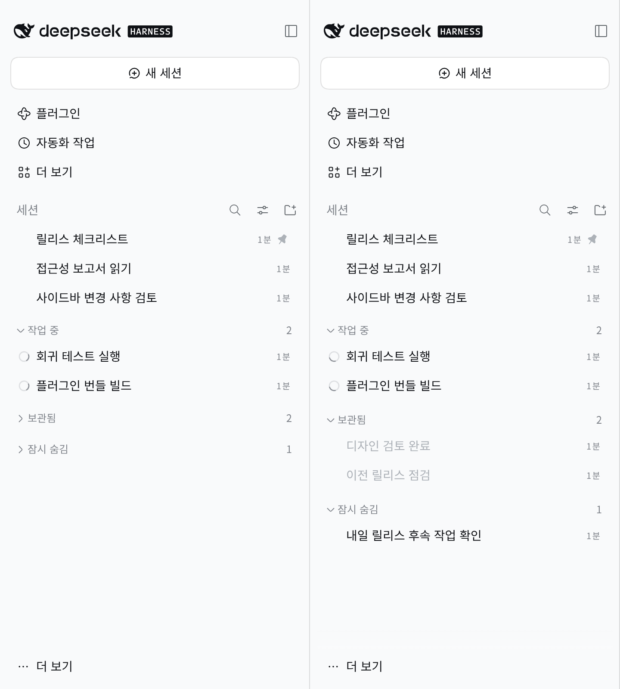
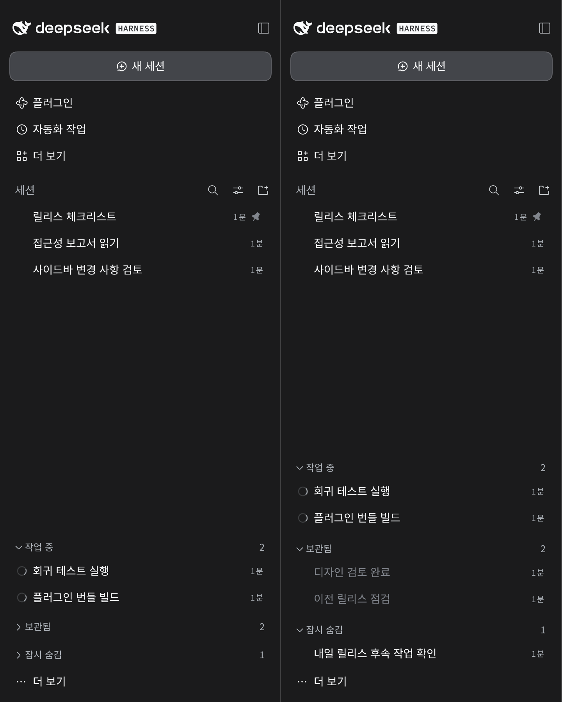

**한국어** | [English](./README.en.md) | [简体中文](./README.zh.md) | [日本語](./README.ja.md) | [Español](./README.es.md) | [Français](./README.fr.md) | [Deutsch](./README.de.md) | [Português](./README.pt.md) | [Русский](./README.ru.md)

# Sidebar Inbox · 사이드바 수신함

`@dungsil/dsh-plugin-ui-sidebar-inbox`

DSH 사이드바의 세션 목록을 T3 Code Nightly처럼 **상태별**로 정리합니다. 응답이 필요한 세션은 위로, 실행 중인 세션과 보관한 세션은 아래로 모아 줍니다. 기존 사이드바의 모양과 세션 행은 그대로 유지합니다.

## 미리보기

**라이트**: 왼쪽은 보관됨을 접은 상태, 오른쪽은 펼친 상태입니다.



**다크**: 같은 예시 세션에서 보관됨을 접은 상태와 펼친 상태를 비교합니다.



## 사용법

1. DSH의 플러그인 관리 화면에서 **Sidebar Inbox / 사이드바 수신함**을 활성화합니다.
2. 처음 활성화하면 보기 옵션이 **그룹 기준: 하나의 목록**, **정렬 기준: 에이전트 활동**으로 자동 설정됩니다. 세션 필터는 바꾸지 않습니다.
3. 다시 켜려면 사이드바의 **보기 옵션**에서 같은 두 항목을 선택합니다.
4. 그만 쓰려면 정렬 기준을 **수동**이나 **최근 수정일**로 바꾸거나, **에이전트 활동**을 한 번 더 선택합니다. 한 번 더 선택하면 에이전트 활동을 켜기 전에 쓰던 정렬로 돌아갑니다.

## 세션 배치

| 영역     | 포함되는 세션                                                                    |
| -------- | -------------------------------------------------------------------------------- |
| Pinned   | DSH에서 고정한 세션입니다. 실행 중이거나 응답이 필요해도 이 영역에 둡니다.       |
| Inbox    | 응답 확인, 승인, 계획 검토, 사용자 입력이 필요하거나 아직 열지 않은 세션입니다.  |
| Working  | 에이전트나 하위 에이전트가 실행 중인 세션입니다. 요청이 생기면 Inbox로 옮깁니다. |
| Archived | DSH에서 보관한 세션입니다. 고정 여부나 실행 상태와 관계없이 이 영역에 둡니다.    |

- 각 영역에서는 최근에 갱신된 세션을 먼저 표시합니다. 내용이 없는 새 세션은 기존 DSH처럼 맨 위에 둡니다.
- 이 배치는 **그룹 기준이 하나의 목록일 때만** 적용됩니다. `작업 공간`이나 `작업 공간 트리`로 바꾸면 에이전트 활동 정렬이 해제되고 DSH 기본 표시로 돌아갑니다.

## 화면 구성

사이드바 목록은 위쪽 목록과 하단 영역으로 나뉘며, 두 영역은 따로 스크롤합니다.

- **위쪽 목록**: Pinned와 Inbox를 제목 없이 표시합니다.
- **하단 영역**: Working과 Archived가 하나의 스크롤 영역을 함께 사용합니다. 제목과 세션을 합친 높이는 사이드바 목록 높이의 50%를 넘지 않습니다.
- **펼침과 접힘**: 처음에는 Working을 펼치고 Archived를 접어 둡니다. 영역 제목을 클릭하거나 키보드로 활성화하면 펼치거나 접을 수 있습니다. 이 상태는 저장하지 않으므로, 새로고침하면 처음 상태로 돌아갑니다.
- **Archived 표시 조건**: 세션 필터가 `모든 대화 (보관된 세션 포함)`일 때만 접을 수 있습니다. `보관된 세션만` 필터에서는 보관한 세션이 목록 전체이므로 항상 펼쳐서 표시합니다.

## 보관

보관 여부는 DSH가 관리합니다. 보관과 보관 해제는 세션의 `⋯` 메뉴에서 실행하며, 이 플러그인은 보관 상태를 저장하거나 바꾸지 않습니다.

- 보관한 세션은 하단 영역에서 언제든 복원할 수 있습니다.
- 실행 중이거나 사용자 응답을 기다리는 세션은 DSH가 보관하기 전에 작업을 먼저 중지합니다.

## 언어

목록 제목과 메뉴 항목은 DSH UI 언어를 따릅니다. 한국어 UI에서는 정렬 항목이 `에이전트 활동`, 영역 제목이 `작업 중`과 `보관됨`으로 표시됩니다. 번역 사전은 플러그인에 포함되어 있으므로 한국어 언어 팩을 따로 설치하지 않아도 됩니다.

## 세부 동작

### 정렬 설정 유지

- 자동 설정은 이전 정렬 기록이 없는 새 설치에서 **처음 활성화할 때 한 번만** 적용됩니다. 그 뒤에는 새로고침하거나 다시 활성화해도 사용자가 고른 보기 옵션을 유지합니다.
- 브라우저 저장소를 사용할 수 없으면 자동 설정을 적용하지 않습니다.
- 선택한 정렬 값(`agent-activity`)은 DSH의 공유 Workspace 보기 저장소에 저장하므로 새로고침 후에도 유지됩니다.
- 플러그인을 비활성화하면 이전에 쓰던 정렬 기준으로 돌아갑니다. 정렬이 어긋나 보이면 보기 옵션에서 **수동**이나 **최근 수정일**을 한 번 선택합니다.

### 수동 정렬과의 관계

세션 행을 드래그하면 DSH가 수동 정렬로 전환하므로 에이전트 활동 정렬이 해제됩니다. 이때 에이전트 활동을 켜기 전에 드래그해 둔 수동 배치는 복원되지 않습니다. 이 동작은 DSH의 정렬 변경 규칙을 그대로 따른 결과입니다.

### 기존 DSH 기능 재사용

- 세션 행, 검색, 메뉴, 선택, 고정, 보관 필터는 DSH의 기존 기능을 그대로 사용합니다.
- CSS로 순서만 바꾸지 않고 DSH의 목록 정렬을 갱신하므로, 화면 순서와 DOM 순서(키보드 이동 순서)가 일치합니다.
- 스크롤바는 DSH 기본 스크롤바의 두께, 색상, 호버 스타일을 따릅니다.

### 애니메이션

| 동작          | 시간  |
| ------------- | ----- |
| Working 펼침  | 320ms |
| Archived 펼침 | 480ms |
| 접힘          | 260ms |

운영체제에서 동작 줄이기(`prefers-reduced-motion`)를 켜면 애니메이션 없이 즉시 바뀝니다.

### 호환성 참고

DSH `0.2.x`의 보기 옵션 메뉴에는 플러그인 확장 슬롯이 없습니다. 따라서 이 플러그인은 다음 내부 구조에 의존하며, DSH가 이 구조를 바꾸면 호환성 갱신이 필요합니다.

- 정렬 항목을 보기 옵션 메뉴의 DOM에 직접 추가합니다.
- 공유 Workspace 보기 저장소와 행의 `data-row-key` 속성을 사용합니다.
- 기본 행을 교체하거나 다른 DOM 부모로 옮기지 않고, Shadow DOM 슬롯으로 위쪽 목록과 하단 영역을 나눕니다. 비활성화하면 기본 슬롯으로 원래 목록을 복원합니다.

## 개발

소스를 변경한 뒤 다음 명령으로 빌드, 타입 검사, 자동 테스트를 실행합니다.

```bash
pnpm --filter @dungsil/dsh-plugin-ui-sidebar-inbox build
pnpm --filter @dungsil/dsh-plugin-ui-sidebar-inbox typecheck
pnpm --filter @dungsil/dsh-plugin-ui-sidebar-inbox test
```

자동 테스트 통과만으로 실제 DSH 화면의 호환성을 확인한 것은 아닙니다. UI를 변경했다면 별도 검증
프로필에서 목록 배치와 조작, 테마, 지원 언어를 직접 확인해야 합니다.
