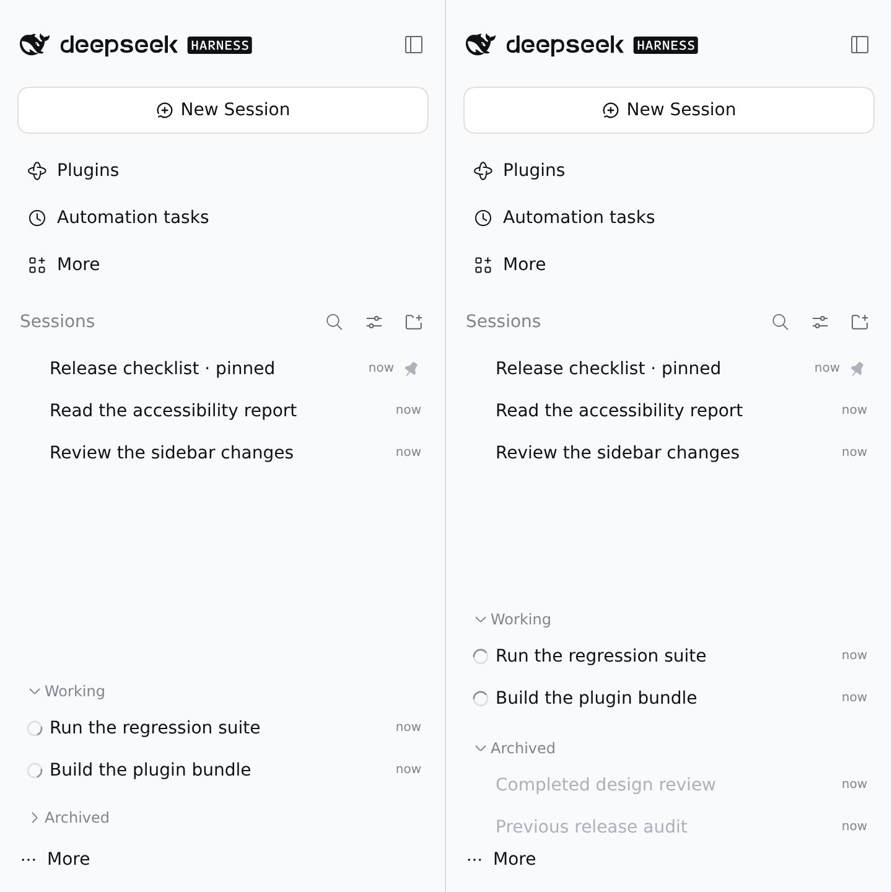
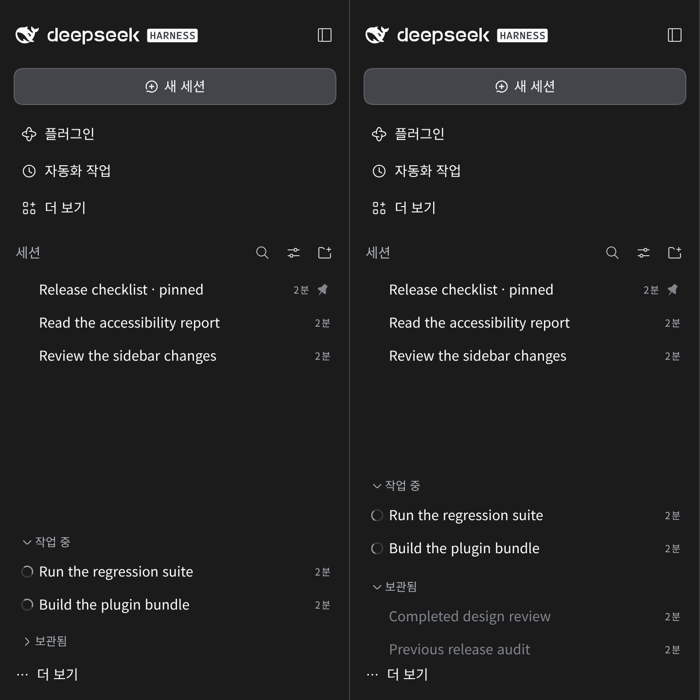

[한국어](./README.md) | [English](./README.en.md) | [简体中文](./README.zh.md) | [日本語](./README.ja.md) | [Español](./README.es.md) | [Français](./README.fr.md) | [Deutsch](./README.de.md) | **Português** | [Русский](./README.ru.md)

# Sidebar Inbox · Caixa de entrada lateral

`@dungsil/dsh-plugin-ui-sidebar-inbox`

Organiza a lista de sessões da barra lateral do DSH **por estado**, como o T3 Code Nightly. As sessões que precisam da sua resposta sobem para o topo, enquanto as sessões em execução e as arquivadas se agrupam embaixo. A aparência da barra lateral e as linhas de sessão existentes continuam iguais.

## Pré-visualização

**Claro · inglês**: à esquerda, Archived recolhido; à direita, expandido.



**Escuro · coreano**: as mesmas sessões de exemplo, comparando 보관됨 (Archived) recolhido e expandido.



## Uso

1. Ative **Sidebar Inbox / Caixa de entrada lateral** na tela de gerenciamento de plugins do DSH.
2. Na primeira ativação, as opções de visualização são definidas automaticamente como **Agrupar por: Em uma lista** e **Encomendar por: Atividade do agente**. O filtro de sessões não é alterado.
3. Para ativá-lo de novo mais tarde, selecione os mesmos dois itens em **Ver opções** na barra lateral.
4. Para deixar de usá-lo, mude **Encomendar por** para **Manuais** ou **Última atualização**, ou selecione **Atividade do agente** novamente. Ao selecioná-lo novamente, volta a ordenação que você usava antes de ativar Atividade do agente.

## Posicionamento das sessões

| Seção    | Sessões incluídas                                                                                                                |
| -------- | -------------------------------------------------------------------------------------------------------------------------------- |
| Pinned   | Sessões fixadas no DSH. Ficam aqui mesmo quando estão em execução ou aguardando resposta.                                        |
| Inbox    | Sessões que precisam de verificação de resposta, aprovação, revisão de plano ou entrada do usuário, e sessões ainda não abertas. |
| Working  | Sessões em que um agente ou subagente está em execução. Passam para Inbox quando surge uma solicitação.                          |
| Archived | Sessões arquivadas no DSH. Ficam aqui independentemente de estarem fixadas ou em execução.                                       |

- Em cada seção, as sessões atualizadas mais recentemente aparecem primeiro. Uma sessão nova vazia fica no topo, como no DSH.
- Esse posicionamento vale **somente quando Agrupar por é Em uma lista**. Ao mudar para `Espaço de trabalho` ou `Árvore do espaço de trabalho`, a ordenação Atividade do agente é desativada e a exibição padrão do DSH volta.

## Layout da tela

A lista da barra lateral é dividida em uma lista superior e uma área inferior, e cada uma rola separadamente.

- **Lista superior**: mostra Pinned e Inbox sem títulos.
- **Área inferior**: Working e Archived compartilham uma área de rolagem. Os títulos e as sessões juntos nunca ocupam mais de 50% da altura da lista da barra lateral.
- **Expandir e recolher**: no início, Working fica expandido e Archived recolhido. Clique no título de uma seção ou ative-o pelo teclado para expandi-la ou recolhê-la. Esse estado não é salvo, então recarregar a página restaura o estado inicial.
- **Quando Archived pode ser recolhido**: somente quando o filtro de sessões é `Todas as conversas (mostrar arquivadas)`. Com o filtro `Somente arquivado`, as sessões arquivadas são a lista inteira, então sempre aparecem expandidas.

## Arquivamento

O DSH gerencia se uma sessão está arquivada. Arquive e desarquive uma sessão pelo menu `⋯` dela; este plugin nunca salva nem altera o estado de arquivamento.

- Você pode restaurar uma sessão arquivada pela área inferior a qualquer momento.
- Se uma sessão estiver em execução ou aguardando sua resposta, o DSH interrompe o trabalho dela antes de arquivá-la.

## Idiomas

Os títulos da lista e os itens de menu seguem o idioma da interface do DSH. Na interface em português, o item de ordenação aparece como `Atividade do agente` e os títulos das seções como `Em andamento` e `Arquivadas`. O plugin inclui suas próprias traduções, então não é preciso instalar um pacote de idioma à parte.

## Comportamento detalhado

### Manter a escolha de ordenação

- A configuração automática é aplicada **apenas uma vez, na primeira ativação** de uma instalação nova sem registro de ordenação anterior. Depois disso, recarregar ou reativar o plugin mantém as opções de visualização que você escolheu.
- Se o armazenamento do navegador não estiver disponível, a configuração automática não é aplicada.
- O valor de ordenação selecionado (`agent-activity`) é salvo no armazenamento de visualização compartilhado do Workspace do DSH, por isso se mantém após recarregar.
- Ao desativar o plugin, volta a ordenação que você usava antes. Se a ordem parecer errada, selecione uma vez **Manuais** ou **Última atualização** nas opções de visualização.

### Relação com a ordenação manual

Ao arrastar uma linha de sessão, o DSH muda para a ordenação manual, o que desativa a ordenação Atividade do agente. A disposição manual que você tinha arrastado antes de ativar Atividade do agente não é restaurada. Isso segue as próprias regras do DSH para mudar a ordenação.

### Reutilização de recursos do DSH

- Linhas de sessão, busca, menus, seleção, fixação e filtro de arquivamento usam os recursos existentes do DSH.
- O plugin atualiza a ordem da lista do DSH em vez de reordenar apenas com CSS, então a ordem na tela coincide com a ordem do DOM (a ordem de navegação pelo teclado).
- As barras de rolagem seguem a espessura, a cor e o estilo ao passar o cursor da barra de rolagem padrão do DSH.

### Animação

| Ação              | Duração |
| ----------------- | ------- |
| Expandir Working  | 320ms   |
| Expandir Archived | 480ms   |
| Recolher          | 260ms   |

Com a opção de reduzir movimento do sistema operacional (`prefers-reduced-motion`) ativada, as mudanças acontecem na hora, sem animação.

### Notas de compatibilidade

O menu de opções de visualização do DSH `0.2.x` não tem um slot de extensão para plugins. Por isso, este plugin depende das estruturas internas abaixo e precisa de uma atualização de compatibilidade se o DSH as mudar.

- Adiciona o item de ordenação diretamente ao DOM do menu de opções de visualização.
- Usa o armazenamento de visualização compartilhado do Workspace e o atributo `data-row-key` das linhas.
- Nunca substitui as linhas padrão nem as move para outro elemento pai do DOM; separa a lista superior e a área inferior com slots de Shadow DOM. Ao desativá-lo, o slot padrão restaura a lista original.

## Desenvolvimento

```bash
pnpm --filter @dungsil/dsh-plugin-ui-sidebar-inbox build
pnpm --filter @dungsil/dsh-plugin-ui-sidebar-inbox typecheck
pnpm --filter @dungsil/dsh-plugin-ui-sidebar-inbox test
```

Os testes automatizados verificam o comportamento a seguir.

- Uma instalação nova aplica a ordenação padrão e depois mantém a escolha do usuário.
- O item de ordenação é adicionado ao menu com a ordem de teclado e a marca de seleção corretas. Quando Agrupar por é diferente, o item é desativado e a ordenação é liberada automaticamente.
- Em uma lista, as sessões são posicionadas por estado, as arquivadas vão para baixo e cada filtro de arquivamento as exibe de forma diferente.
- Working e Archived começam expandido e recolhido e alternam pelos títulos; o desarquivamento é refletido; os títulos são atualizados quando o idioma da interface muda.
- Liberar a ordenação restaura a ordem anterior.
