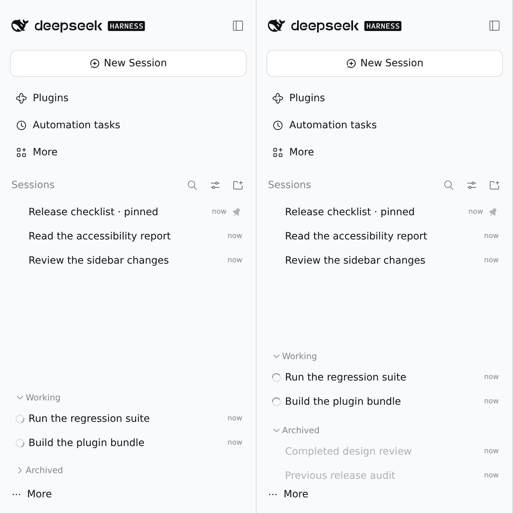
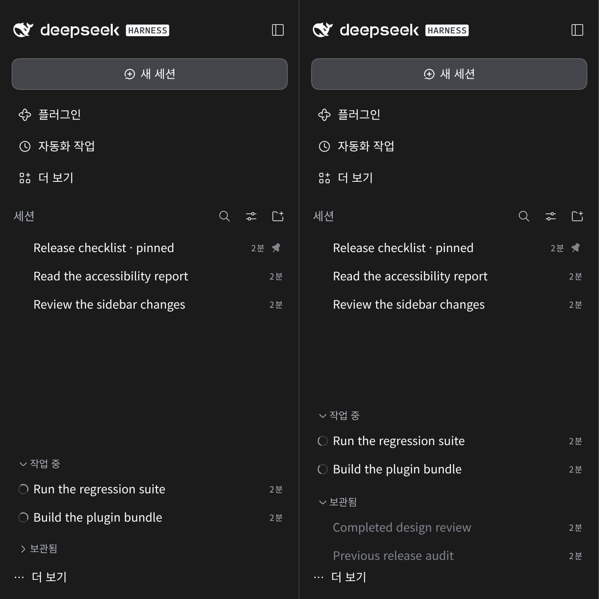

[한국어](./README.md) | [English](./README.en.md) | [简体中文](./README.zh.md) | [日本語](./README.ja.md) | [Español](./README.es.md) | [Français](./README.fr.md) | [Deutsch](./README.de.md) | [Português](./README.pt.md) | **Русский**

# Sidebar Inbox · Входящие на боковой панели

`@dungsil/dsh-plugin-ui-sidebar-inbox`

Плагин упорядочивает список сеансов на боковой панели DSH **по состоянию**, как в T3 Code Nightly. Сеансы, которые ждут вашего ответа, поднимаются вверх, а выполняющиеся и архивные сеансы собираются внизу. Внешний вид боковой панели и строки сеансов остаются прежними.

## Предпросмотр

**Светлая тема · английский**: слева Archived свёрнут, справа развёрнут.



**Тёмная тема · корейский**: те же примеры сеансов; сравнение свёрнутого и развёрнутого 보관됨 (Archived).



## Использование

1. Включите **Sidebar Inbox / Входящие на боковой панели** на экране управления плагинами DSH.
2. При первом включении параметры вида автоматически принимают значения **Группировать по: В одном списке** и **Заказать по: Активность агента**. Фильтр сеансов не меняется.
3. Чтобы позже включить режим снова, выберите эти же два пункта в меню **Посмотреть варианты** на боковой панели.
4. Чтобы перестать пользоваться режимом, переключите **Заказать по** на **Руководство** (ручной порядок) или **Последнее обновление** либо ещё раз выберите **Активность агента**. При повторном выборе вернётся порядок, который действовал до включения сортировки «Активность агента».

## Размещение сеансов

| Раздел   | Какие сеансы входят                                                                                                  |
| -------- | -------------------------------------------------------------------------------------------------------------------- |
| Pinned   | Сеансы, закреплённые в DSH. Остаются здесь, даже если выполняются или ждут ответа.                                   |
| Inbox    | Сеансы, где нужно проверить ответ, дать одобрение, проверить план или ввести данные, а также ещё не открытые сеансы. |
| Working  | Сеансы, в которых выполняется агент или субагент. При появлении запроса переходят в Inbox.                           |
| Archived | Сеансы, архивированные в DSH. Остаются здесь независимо от закрепления и состояния выполнения.                       |

- Внутри каждого раздела первыми идут недавно обновлённые сеансы. Пустой новый сеанс, как и в DSH, остаётся вверху.
- Такое размещение действует **только когда «Группировать по» имеет значение «В одном списке»**. При переключении на `Рабочее пространство` или `Дерево рабочей области` сортировка «Активность агента» снимается и возвращается стандартное отображение DSH.

## Структура экрана

Список на боковой панели делится на верхний список и нижнюю область, которые прокручиваются независимо.

- **Верхний список**: показывает Pinned и Inbox без заголовков.
- **Нижняя область**: Working и Archived используют общую область прокрутки. Их заголовки и сеансы вместе занимают не больше 50% высоты списка боковой панели.
- **Развёртывание и свёртывание**: сначала Working развёрнут, а Archived свёрнут. Щёлкните заголовок раздела или активируйте его с клавиатуры, чтобы развернуть или свернуть раздел. Это состояние не сохраняется: после перезагрузки восстанавливается исходное.
- **Когда Archived можно свернуть**: только если фильтр сеансов — `Все разговоры (показать в архиве)`. С фильтром `Только в архиве` архивные сеансы составляют весь список, поэтому всегда показываются развёрнутыми.

## Архивирование

Архивным состоянием сеансов управляет DSH. Архивируйте и разархивируйте сеанс через его меню `⋯`; плагин никогда не сохраняет и не меняет архивное состояние.

- Архивный сеанс можно в любой момент восстановить из нижней области.
- Если сеанс выполняется или ждёт вашего ответа, DSH останавливает его работу перед архивированием.

## Языки

Заголовки списка и пункты меню следуют языку интерфейса DSH. В русском интерфейсе пункт сортировки называется `Активность агента`, а заголовки разделов — `В работе` и `Архивные`. Плагин содержит собственные переводы, поэтому отдельный языковой пакет не нужен.

## Подробности работы

### Сохранение выбранной сортировки

- Автоматическая настройка применяется **только один раз — при первом включении** в новой установке без сохранённой прежней сортировки. После этого перезагрузка или повторное включение плагина сохраняют выбранные вами параметры вида.
- Если хранилище браузера недоступно, автоматическая настройка не применяется.
- Выбранное значение сортировки (`agent-activity`) сохраняется в общем хранилище вида Workspace в DSH и поэтому сохраняется после перезагрузки.
- При отключении плагина возвращается порядок, который использовался раньше. Если порядок выглядит неправильно, один раз выберите в параметрах вида **Руководство** или **Последнее обновление**.

### Связь с ручной сортировкой

Если перетащить строку сеанса, DSH переключается на ручную сортировку, и сортировка «Активность агента» снимается. Ручное расположение, созданное перетаскиванием до включения «Активности агента», не восстанавливается. Так работают собственные правила DSH для смены сортировки.

### Повторное использование функций DSH

- Строки сеансов, поиск, меню, выделение, закрепление и фильтр архива используют существующие функции DSH.
- Плагин обновляет порядок списка DSH, а не меняет его только через CSS, поэтому порядок на экране совпадает с порядком в DOM (порядком навигации с клавиатуры).
- Полосы прокрутки повторяют толщину, цвет и стиль наведения стандартной полосы прокрутки DSH.

### Анимация

| Действие               | Длительность |
| ---------------------- | ------------ |
| Развёртывание Working  | 320ms        |
| Развёртывание Archived | 480ms        |
| Свёртывание            | 260ms        |

Если в операционной системе включено уменьшение движения (`prefers-reduced-motion`), изменения применяются сразу, без анимации.

### Замечания о совместимости

В меню параметров вида DSH `0.2.x` нет слота расширения для плагинов. Поэтому плагин зависит от перечисленных ниже внутренних структур и требует обновления совместимости, если DSH их изменит.

- Пункт сортировки добавляется прямо в DOM меню параметров вида.
- Используются общее хранилище вида Workspace и атрибут `data-row-key` у строк.
- Стандартные строки не заменяются и не переносятся в другой родительский элемент DOM; верхний список и нижняя область разделяются слотами Shadow DOM. После отключения стандартный слот восстанавливает исходный список.

## Разработка

```bash
pnpm --filter @dungsil/dsh-plugin-ui-sidebar-inbox build
pnpm --filter @dungsil/dsh-plugin-ui-sidebar-inbox typecheck
pnpm --filter @dungsil/dsh-plugin-ui-sidebar-inbox test
```

Автоматические тесты проверяют следующее поведение.

- Новая установка применяет сортировку по умолчанию, а затем сохраняет выбор пользователя.
- Пункт сортировки добавляется в меню с правильным порядком клавиатурной навигации и отметкой выбора. При другой группировке пункт отключается, а сортировка автоматически снимается.
- В одном списке сеансы размещаются по состоянию, архивные сеансы уходят вниз, а каждый фильтр архива показывает их по-своему.
- Working и Archived изначально развёрнут и свёрнут и переключаются по заголовкам; разархивирование учитывается; заголовки обновляются при смене языка интерфейса.
- Снятие сортировки восстанавливает прежний порядок.
