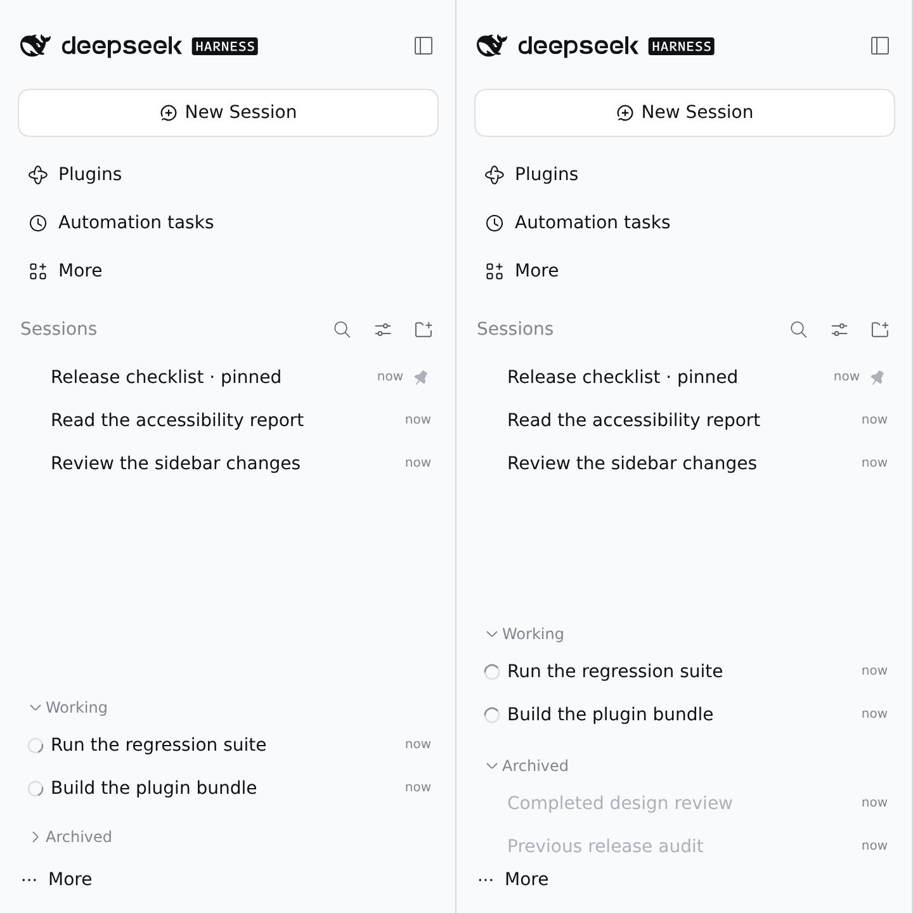
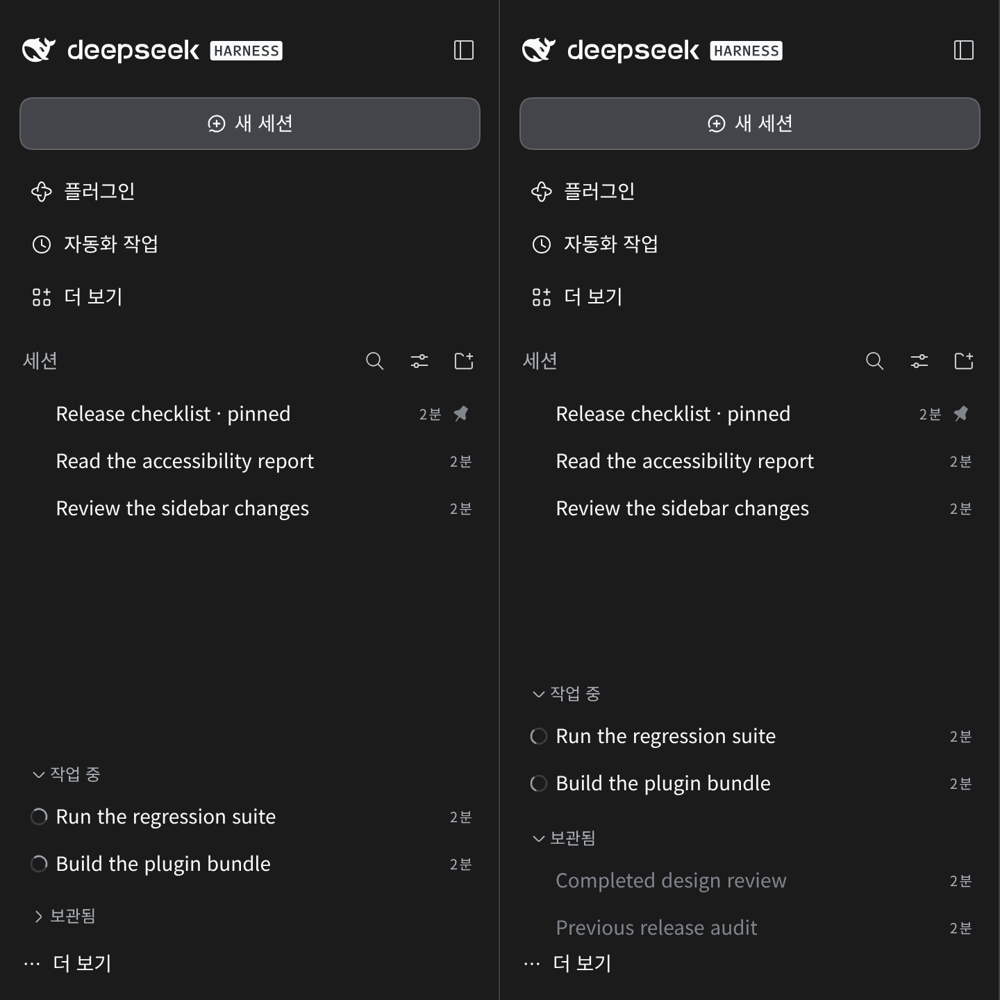

[한국어](./README.md) | [English](./README.en.md) | **简体中文** | [日本語](./README.ja.md) | [Español](./README.es.md) | [Français](./README.fr.md) | [Deutsch](./README.de.md) | [Português](./README.pt.md) | [Русский](./README.ru.md)

# Sidebar Inbox · 侧边栏收件箱

`@dungsil/dsh-plugin-ui-sidebar-inbox`

本插件像 T3 Code Nightly 一样，将 DSH 侧边栏的会话列表**按状态**整理。需要你回复的会话移到上方，运行中的会话和已归档的会话集中在下方。侧边栏原有的外观和会话行保持不变。

## 预览

**浅色 · 英语**：左侧为 Archived 折叠状态，右侧为展开状态。



**深色 · 韩语**：使用相同的示例会话，对比 보관됨（Archived）的折叠与展开。



## 使用方法

1. 在 DSH 的插件管理界面中启用 **Sidebar Inbox / 侧边栏收件箱**。
2. 首次启用时，视图选项会自动设为 **分组方式：单列表**、**排序方式：Agent activity**。会话筛选不会改变。
3. 之后要重新开启，请在侧边栏的 **视图选项** 中选择相同的两项。
4. 要停止使用，请将排序方式改为 **手动排序** 或 **最近更新**，或再次选择 **Agent activity**。再次选择时，会恢复开启 Agent activity 之前使用的排序。

## 会话分区

| 分区     | 包含的会话                                                     |
| -------- | -------------------------------------------------------------- |
| Pinned   | 在 DSH 中置顶的会话。即使正在运行或等待回复，也留在此分区。    |
| Inbox    | 需要查看回复、批准、审阅计划、需要用户输入，或尚未打开的会话。 |
| Working  | 智能体或子智能体正在运行的会话。出现请求时移到 Inbox。         |
| Archived | 在 DSH 中归档的会话。无论是否置顶或正在运行，都留在此分区。    |

- 每个分区内，最近更新的会话排在前面。没有内容的新会话与 DSH 默认行为一样置于最上方。
- 此分区**仅在分组方式为单列表时**生效。切换到 `按工作区` 或 `按工作区树` 时，Agent activity 排序会被解除，并恢复 DSH 的默认显示。

## 界面布局

侧边栏列表分为上方列表和下方区域，两者各自滚动。

- **上方列表**：不带标题地显示 Pinned 和 Inbox。
- **下方区域**：Working 和 Archived 共用一个滚动区域。两者的标题与会话合计高度不超过侧边栏列表高度的 50%。
- **展开与折叠**：初始时 Working 展开、Archived 折叠。点击分区标题或用键盘激活即可展开或折叠。此状态不会保存，刷新后恢复初始状态。
- **Archived 的折叠条件**：仅当会话筛选为 `全部对话（显示已归档）` 时才能折叠。在 `仅显示已归档` 筛选下，已归档会话就是整个列表，因此始终展开显示。

## 归档

会话是否归档由 DSH 管理。归档和取消归档在会话的 `⋯` 菜单中执行，本插件不会保存或修改归档状态。

- 已归档的会话随时可以在下方区域中恢复。
- 对于正在运行或等待你回复的会话，DSH 会在归档前先停止其工作。

## 语言

列表标题和菜单项跟随 DSH 的界面语言。插件自带英语、韩语、日语、西班牙语、法语、德语、俄语和葡萄牙语的译文，但不含中文译文。因此在中文界面中，这些文字会按 DSH 的回退规则以英语显示：排序项为 `Agent activity`，分区标题为 `Working` 和 `Archived`。

## 详细行为

### 保留排序选择

- 自动设置**仅在新安装且没有以前的排序记录时，于首次启用时应用一次**。之后即使刷新或重新启用，也会保留你选择的视图选项。
- 浏览器存储不可用时，不会应用自动设置。
- 所选排序值（`agent-activity`）保存在 DSH 共享的 Workspace 视图存储中，因此刷新后依然保留。
- 停用插件后，会恢复之前使用的排序。如果排序看起来不对，请在视图选项中选择一次 **手动排序** 或 **最近更新**。

### 与手动排序的关系

拖动会话行时，DSH 会切换为手动排序，因此 Agent activity 排序会被解除。开启 Agent activity 之前拖动好的手动排列不会恢复。此行为直接遵循 DSH 的排序变更规则。

### 复用 DSH 现有功能

- 会话行、搜索、菜单、选择、置顶和归档筛选都直接使用 DSH 的现有功能。
- 插件更新 DSH 的列表顺序，而不是仅用 CSS 调整顺序，因此屏幕顺序与 DOM 顺序（键盘导航顺序）一致。
- 滚动条遵循 DSH 默认滚动条的粗细、颜色和悬停样式。

### 动画

| 操作          | 时长  |
| ------------- | ----- |
| 展开 Working  | 320ms |
| 展开 Archived | 480ms |
| 折叠          | 260ms |

开启操作系统的减少动态效果（`prefers-reduced-motion`）设置时，会立即切换而不播放动画。

### 兼容性说明

DSH `0.2.x` 的视图选项菜单没有插件扩展槽。因此本插件依赖以下内部结构，若 DSH 更改这些结构，需要进行兼容性更新。

- 将排序项直接添加到视图选项菜单的 DOM 中。
- 使用共享的 Workspace 视图存储和行上的 `data-row-key` 属性。
- 不替换默认行，也不把它们移到其他 DOM 父节点，而是用 Shadow DOM 插槽划分上方列表和下方区域。停用后，默认插槽会恢复原有列表。

## 开发

```bash
pnpm --filter @dungsil/dsh-plugin-ui-sidebar-inbox build
pnpm --filter @dungsil/dsh-plugin-ui-sidebar-inbox typecheck
pnpm --filter @dungsil/dsh-plugin-ui-sidebar-inbox test
```

自动测试检查以下行为。

- 新安装时应用默认排序，之后保留用户的选择。
- 在菜单中添加排序项，并保持键盘顺序和选中标记。分组方式不同时禁用该项并自动解除排序。
- 在单列表中按状态排列，将已归档会话放在下方，并按归档筛选分别显示。
- Working 和 Archived 的默认展开与折叠、标题切换、取消归档的反映，以及随界面语言切换更新标题。
- 解除排序时恢复之前的排序。
