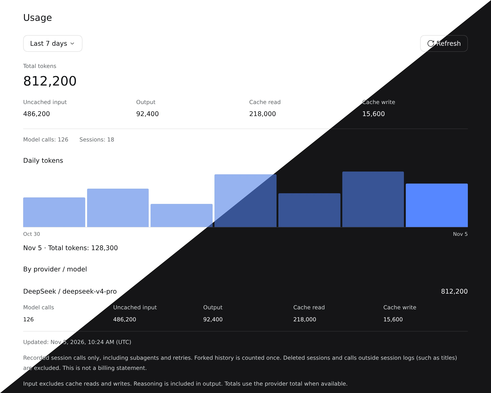

# Usage Dashboard · 사용량 대시보드

DSH Web 사이드바에서 세션에 기록된 토큰 사용량, 일별 추이와 제공자·모델별 사용량을 확인합니다. 청구서나 제공자 계정의 잔액 조회 화면은 아닙니다.

위 이미지는 최신 빌드의 실제 플러그인 컴포넌트에 예시 사용량 응답과 공식 DSH 테마·UI primitives를 제공한 독립 브라우저 화면을 각각 캡처해 합성했습니다. 실제 DSH 세션 화면은 아니며, 모델·날짜·수치는 모두 예시입니다.

## 사용 방법

1. DSH 플러그인 설치 화면에서 `@dungsil/dsh-plugin-ui-usage`를 설치하고 활성화합니다.
2. 사이드바의 **사용량**을 엽니다. **최근 7일**, **최근 30일**, **전체 기간** 중 조회 범위를 선택합니다.
3. 일별 막대를 눌러 해당 날짜의 토큰 수를 확인합니다. 최신 기록을 다시 읽으려면 **새로고침**을 누릅니다.

## 집계 범위와 호환성

- DSH `0.2.1-rc.5` 이상 `0.3.0` 미만의 Web UI를 지원합니다. 한국어·영어·중국어(간체)와 DSH 테마를 따릅니다.
- 세션에 기록된 호출만 집계하며 하위 에이전트와 재시도를 포함합니다. 분기에서 상속된 기록은 한 번만 셉니다. 삭제한 세션과 제목 생성 등 세션 밖 호출은 제외합니다.
- 입력은 캐시 읽기·쓰기를 제외하고, 추론 토큰은 출력에 포함합니다. 제공자가 전체 토큰 수를 보고하면 해당 값을 사용합니다. 토큰 수 미보고 호출이나 읽지 못한 세션은 별도로 알립니다.
- 날짜는 브라우저 시간대를 사용합니다. 전체 기간을 선택해도 일별 차트는 최근 30일을 표시합니다. 자동 실시간 갱신 대신 새로고침으로 기록을 다시 조회합니다.
