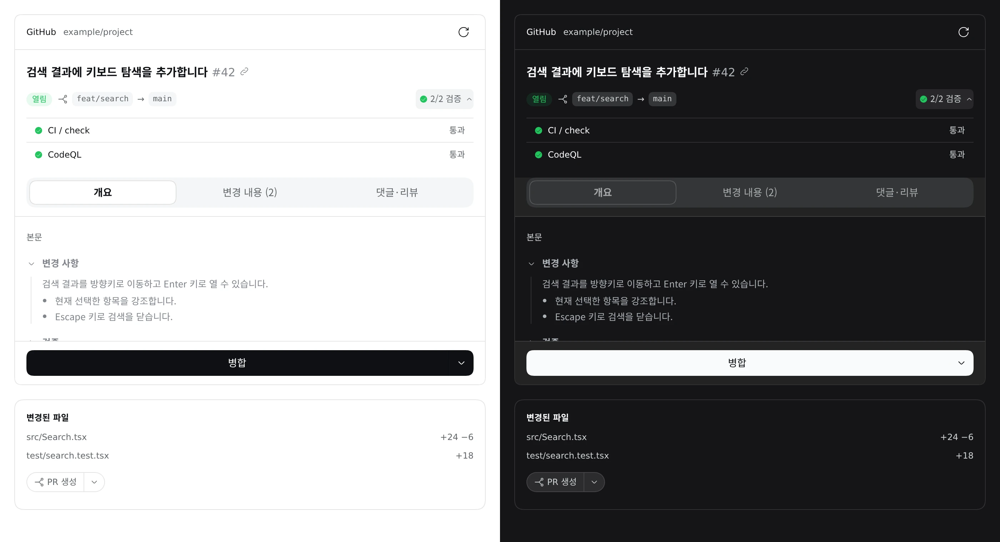

# 버전 관리

DSH에서 에이전트에게 Git 작업을 요청하고, 오른쪽 사이드바에서 PR/MR의 본문·CI·변경 내용·댓글을 확인합니다. GitHub, GitLab, Gitea, Forgejo를 지원합니다.

위 이미지는 최신 빌드의 실제 PR 패널과 Git 작업 버튼에 예시 PR·CI 응답을 제공한 독립 검증 화면을 캡처해, 좌측 라이트·우측 다크 모드의 전체 화면을 나란히 이어 붙였습니다. DSH `0.2.1-rc.5`의 공식 테마와 공통 컴포넌트를 사용했습니다. 저장소·브랜치·검사 결과는 예시이며, 실제 원격 저장소에 PR을 생성하거나 병합한 화면은 아닙니다. 아래 파일 카드는 작업 버튼을 보여 주기 위한 예시입니다.

## 사용 방법

1. 플러그인 관리 화면에서 **버전 관리**를 활성화합니다. DSH `^0.2.1-rc.5`의 Web UI를 지원합니다.
2. 대화에 변경된 파일 카드가 표시되면 입력창 아래의 Git 작업 버튼을 사용합니다. 기본 브랜치에서는 **푸시**, 기능 브랜치나 worktree에서는 **PR 생성**을 요청합니다. 옆 메뉴에서는 **커밋만** 요청할 수 있습니다.
3. 오른쪽 사이드바에서 **PR / MR**을 열어 현재 브랜치의 요청을 확인합니다. **개요**, **변경 내용**, **댓글·리뷰** 탭을 전환하고 CI 요약을 눌러 개별 검사 결과를 펼칩니다.
4. 댓글·리뷰를 제출하거나 병합하려면 확인 창에서 대상과 작업을 확인합니다. 병합 방식은 병합 버튼 옆 메뉴에서 선택합니다.

## 동작 범위

- Git 작업 버튼은 에이전트에게 선택한 작업만 요청합니다. 작성 중인 입력창 초안과 첨부를 전송하거나 지우지 않습니다.
- PR/MR 조회와 작업에는 해당 호스팅 서비스에 인증된 `gh`, `glab`, `tea` CLI가 필요합니다. 자체 호스팅 인스턴스는 명시적인 provider 설정으로 지원합니다.
- PR/MR 패널은 CI, 리뷰, 병합 가능 상태를 확인하며, 허용되지 않는 상태에서는 병합을 비활성화합니다. 댓글·리뷰·병합은 확인 후 실행하고, 응답이 불확실하면 자동 재시도하지 않습니다.
- 영어·한국어·중국어 UI를 지원합니다. 원격 작업을 요청하기 전에 표시된 저장소와 브랜치를 확인하세요.
