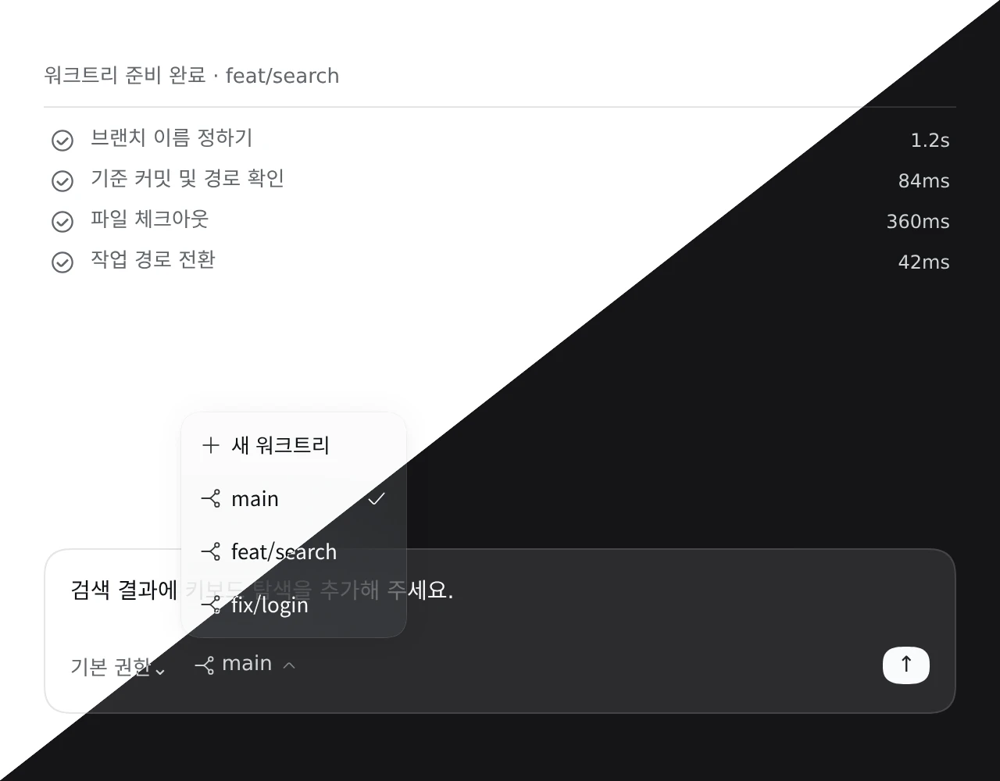

# @dungsil/dsh-plugin-ui-worktree



DSH 입력창의 권한 선택 옆에 **Worktree 선택 상자**를 추가합니다. 첫 작업 전에는 현재 체크아웃을 유지하거나 새 워크트리 생성을 예약할 수 있습니다. 프롬프트를 전송하면 내부에서 자동으로 이름을 정하고 생성·전환한 뒤 같은 세션에서 원래 작업을 시작합니다. 작업을 시작한 뒤에는 워크트리를 바꿀 수 없으며, 작성 중인 메시지·파일 참조·첨부는 그대로 유지합니다.

위 이미지는 최신 빌드의 실제 선택 상자와 진행 상태 컴포넌트에 예시 워크트리·완료 기록을 제공한 독립 검증 화면을 캡처해, 좌측 라이트·우측 다크 모드의 전체 화면을 나란히 이어 붙였습니다. DSH `0.2.1-rc.5`의 공식 테마와 공통 컴포넌트를 사용했으며, 브랜치 이름과 소요 시간은 예시입니다. 실제 Git 생성 작업을 촬영한 화면은 아닙니다.

## 사용법

1. 플러그인 관리 화면에서 **Git Worktree UI**를 활성화합니다. 공식 모델용 Git worktrees 도구를 따로 켤 필요가 없습니다.
2. 입력창의 선택 상자에서 현재 체크아웃의 이름을 확인합니다. 다른 기존 worktree로 이동하는 항목은 제공하지 않습니다.
3. **새 워크트리**를 선택합니다. 별도 입력 창 없이 **새 워크트리**로 표시하며, 이때는 브랜치나 경로를 만들지 않습니다. 다음 일반 프롬프트를 전송하면 해당 프롬프트로 이름을 정하고 생성·전환합니다. 대화 영역에서 단계별 진행 상태와 소요 시간을 확인할 수 있으며, 생성과 전환이 끝난 뒤에 실제 브랜치 이름을 표시합니다.
4. 첫 작업 전에는 현재 체크아웃을 다시 선택해 생성 예약을 취소할 수 있습니다. 작업을 시작한 뒤에는 현재 브랜치를 표시만 합니다. 다른 워크트리에서 작업하려면 해당 경로로 새 세션을 만듭니다.
5. 오류가 발생하면 선택 상자 안에 **조회 실패** 또는 **변경 확인 필요**를 표시하며, 선택 상자를 누르면 상세 창을 엽니다. **워크트리 새로고침**으로 실제 상태를 확인할 수 있습니다. 생성에 실패하면 상세 창에서 **워크트리 선택**을 눌러 현재 체크아웃을 유지하거나 다시 예약한 뒤 프롬프트를 다시 전송합니다. 취소하면 시작 이력에 따라 선택이 고정됩니다. 다음 프롬프트나 새로고침만으로 생성을 자동 재시도하지 않습니다.

## 동작 범위

- `create_worktree` 도구나 `session.prompt()`를 호출하지 않습니다. 생성 지시를 사용자 메시지에 추가하지 않으며 예약 자체도 모델을 호출하지 않습니다. 방금 전송한 프롬프트로 도구 없는 별도 모델 호출을 수행해 이름을 정하므로 모델 설정과 호출 비용이 필요합니다. 진행 상태는 모델 입력에 포함되지 않는 세션 기록으로 저장하며, 브라우저를 새로고침해도 완료·실패 상태가 유지됩니다. 실제로 실행하지 않는 fetch나 설정 스크립트 단계를 표시하지 않습니다.
- **상황별 모델** 플러그인을 함께 사용하면 **설정 → 상황별 모델 → 워크트리 브랜치 이름**에서 자동 이름 생성 모델과 추론 수준을 별도로 지정할 수 있습니다. `provider`·`model`·`reasoningEffort` 설정은 이 플러그인에 저장하며 대화 모델과 제목 모델은 변경하지 않습니다. 추론 수준의 자동은 모델 기본값을 사용합니다. 모델 기본값이 없으면 지원 목록에서 `off`를 제외한 첫 번째 수준을 선택합니다. 추론 기능이 없으면 추론 수준을 보내지 않습니다. 모델을 지정하지 않으면 대화 모델만 따르고 대화의 추론 수준은 상속하지 않습니다. 워크트리 경로·이름 규칙을 저장해도 지정한 모델과 추론 수준은 유지됩니다.
- 소유자 전용 API로 현재 상태를 조회하고 생성 예약을 처리합니다. 목록은 `git worktree list --porcelain -z`로 읽으며, 실제 생성은 일반 사용자 프롬프트를 받은 뒤 `agent/pre-step`에서 세션의 파일 접근 정책으로 제한한 Git 프로세스로 수행합니다. 새 체크아웃 진입은 기존 `workingDirectory` 서비스를 사용하며 Git hook과 checkout filter는 실행하지 않습니다. 기존 워크트리로 전환하는 `switch` API는 제공하지 않고 `select`는 `current`와 `new`만 허용합니다.
- 세션의 기존 파일 접근 정책을 유지합니다. 읽기 전용 정책에서는 생성이 거부되며, 기존 브랜치·경로는 덮어쓰지 않습니다. 커밋하지 않은 변경은 원래 체크아웃에 남습니다.
- 세션 최초 진입과 작업 경로 변경 시 현재 워크트리를 조회합니다. 동기화 후에는 포커스 복귀·작업 종료·메뉴 열기만으로 반복 조회하지 않으며, 고정된 세션은 화면을 이동했다 돌아와도 동기화 결과를 재사용합니다. 세션을 불러오는 동안이나 삭제한 세션에서는 조회를 보류합니다. 조회는 세션 기록과 예약을 변경하지 않으며, 작업 경로를 자동 복구하지 않습니다. 실제 조회 오류와 생성 결과가 불확실한 상태는 명시적 확인 전까지 유지합니다.
- 기본 선택의 예약과 초기화 기록은 별도 `initialize` 요청으로 처리합니다. 세션이 유휴 상태일 때만 초기화하며, 반복 요청으로 예약을 중복 생성하거나 취소한 예약을 복원하지 않습니다. 생성 중임을 나타내는 내부 재시도 차단 상태는 조회 화면에 실패로 표시하지 않습니다.
- 서버는 생성 예약의 중복 실행과 오래된 현재 경로를 거부하며, 작업을 시작한 세션에서 예약이 없으면 선택 변경도 거부합니다. 선택을 저장하는 동안에는 프롬프트 전송을 막고, 빠르게 선택을 바꾸면 최신 선택만 반영합니다. 전송 시점의 생성 예약은 해당 프롬프트에 고정합니다. 생성 유지보수 구간에서는 새 모델 실행이 대기하지만, 목록 조회는 모델 실행을 막지 않습니다.
- 영어·한국어·중국어 UI, Escape 닫기와 키보드 탐색을 지원합니다. 예약은 실행 중인 서버의 세션별 Agent에 보관하므로 브라우저 새로고침이나 다른 세션 이동 후에도 유지되지만, Agent 해제·서버 재시작·플러그인 재시작 시에는 취소됩니다. 보관 시 삭제는 설정에서 별도로 켤 수 있습니다.
- 현재 worktree를 찾을 때 Windows 경로의 구분자와 드라이브 문자 대소문자를 맞춥니다. 실제 생성이나 전환에 쓰는 경로와 POSIX 파일 이름의 역슬래시는 바꾸지 않습니다.
- 조회 실패와 변경 결과를 확인하지 못한 상태를 구분합니다. 브라우저 콘솔의 `[dungsil-ui-worktree]` 로그에는 요청 종류와 허용된 오류 코드만 기록합니다. 서버 오류 원문, 인증 정보, 세션 식별자, 작업 경로는 기록하지 않습니다.

## 워크트리 설정

DSH **설정 → 워크트리**에서 값을 변경하면 현재 프로필에 자동으로 저장합니다. 설정 화면을 열면 저장된 값을 자동으로 불러옵니다. 생성 설정은 다음 생성부터 적용하며 기존 worktree는 이동하거나 이름을 바꾸지 않습니다.

- **워크트리 풀 디렉터리**: 기본값은 `.agents/worktrees`입니다. 원본 체크아웃의 저장소 루트 기준 상대경로(`../worktrees` 포함) 또는 절대경로를 지정합니다. 실제 체크아웃은 이 디렉터리 아래의 브랜치 이름 경로에 생성됩니다. 설정한 경로도 세션의 파일 접근 정책을 따라야 합니다.
- **추적 중인 원격 브랜치 사용**: 기본값은 꺼짐이며 현재 HEAD를 기준으로 생성합니다. 켜면 현재 브랜치의 upstream인 `refs/remotes/...` 커밋을 사용합니다. 자동 fetch는 하지 않으며 upstream이 없거나 로컬 브랜치를 추적하면 생성을 거부합니다.
- **보관 시 워크트리 삭제**: 기본값은 꺼짐입니다. 켜면 이후 세션을 보관할 때, 이 플러그인이 해당 세션에서 마지막으로 생성한 현재 워크트리를 삭제합니다. 소유 기록이 없는 이전 버전의 워크트리, 외부에서 만든 워크트리, 미커밋·미추적·무시된 파일이 있거나 잠긴 워크트리, 다른 세션이 사용하는 워크트리는 유지합니다. 브랜치와 커밋은 삭제하지 않으며 세션은 원본 체크아웃으로 돌아갑니다. 이미 보관된 세션을 소급하여 정리하지 않으며, 삭제하지 못해도 보관은 유지하고 강제 삭제나 자동 재시도는 하지 않습니다.
- **자동 브랜치 이름 형식**: 시멘틱(예: `feat/search`, `fix/login`), `dsh/*`, 사용자 지정 접두사(예: `team/`, `task-`)를 선택합니다. 기본값은 시멘틱입니다.
- 경로와 접두사는 유효한 값을 입력할 때 자동으로 저장합니다. 빈 경로나 잘못된 접두사는 오류를 표시하며 저장하지 않습니다. 연속으로 수정하면 진행 중인 저장이 끝난 뒤 최신 값을 저장합니다.
- 저장에 실패하거나 다른 화면의 변경과 충돌하면 오류를 표시하고 저장된 값을 자동으로 다시 불러옵니다. 실패한 변경은 자동으로 재시도하지 않습니다. 값을 확인한 뒤 다시 수정합니다. 다시 불러오지 못하면 연결을 확인한 뒤 설정 화면을 다시 엽니다. 워크트리 작업 중에는 설정 저장을 거부하므로 작업이 끝난 뒤 수정합니다.

## 설치

DSH 지원 범위는 `^0.2.1-rc.5`입니다. npm 배포 전에는 저장소에서 패키지를 생성해 설치합니다.

```bash
pnpm --filter @dungsil/dsh-plugin-ui-worktree pack --pack-destination ../../release
dsh plugin --profile web add ./release/dungsil-dsh-plugin-ui-worktree-0.1.1.tgz
```

플러그인 관리 화면에서 **Git Worktree UI**를 활성화합니다. 공식 모델용 Git worktrees 도구는 선택 사항이며, 이 UI의 설정은 해당 도구의 설정을 바꾸지 않습니다.

## 검증

```bash
pnpm --filter @dungsil/dsh-plugin-ui-worktree build
pnpm --filter @dungsil/dsh-plugin-ui-worktree typecheck
pnpm --filter @dungsil/dsh-plugin-ui-worktree test
```

클라이언트 테스트는 빌드한 번들의 슬롯 진입점을 VM에서 실행합니다. 실행·전송 대기 중의 목록 조회와 변경 차단, 유휴 상태의 초기화, 세션 이동 시 효과 정리와 요청 취소를 확인합니다. 초기화의 일시적인 `busy` 응답과 명시적 새로고침이 필요한 오류도 구분합니다. 이 테스트는 실제 브라우저 화면이나 언어 전환을 검증하지 않습니다.

서버 테스트는 실제 Git 저장소와 AgentLoop를 실행하며 파일 접근 정책과 소유자 인증 경계를 사용합니다. 예약 시 부작용이 없는지, 첫 모델 작업이 새 경로에서 실행되는지, 실패 시 작업과 자동 재시도를 차단하는지 검증합니다. 이름을 입력하면 이름 생성용 모델을 호출하지 않고, 빈 이름의 경우 방금 전송한 프롬프트를 사용하는지도 확인합니다. 실제 프로필 저장과 Loader 재적용, 상대·절대경로, 로컬 HEAD와 다른 원격 기준 커밋, 자동 이름 규칙, hook·filter 실행 차단도 확인합니다.

### 2026-11-04: 실제 모델의 추론 옵션 오류 수정

이름을 직접 입력하면 생성에 성공하지만 자동 이름 생성은 `operation_failed`로 실패하는 사례를 실제 DSH에서 관찰했습니다. 모델 호출은 `INVALID_REQUEST`로 종료했고 텍스트는 생성하지 않았습니다. 앞서 수정한 256토큰 제한은 이 실패의 원인이 아니었습니다.

모델 기본 추론 수준이 없는 상태에서 옵션을 생략하면 SDK가 `reasoning.effort: "none"`을 보냈습니다. 현재 모델은 `none`을 거부하고 `low`, `medium`, `high`, `xhigh`, `max`를 허용했습니다. 같은 실제 모델에 기본 옵션, 명시적 `low`, 기본 옵션 순서로 이름 생성 요청을 보냈습니다. 결과는 오류, 유효한 이름 생성, 동일 오류였습니다. 대화 내용과 모델 응답 원문, 인증 정보는 진단 기록에 저장하지 않았습니다.

수정은 `prepareCall`에서 추론 수준을 결정하는 단계에만 적용했습니다. 우선순위는 사용자가 지정한 값, 모델 기본값, 지원 목록에서 `off`를 제외한 첫 번째 값입니다. 대화의 추론 수준은 상속하지 않으며 모델 호출을 자동으로 재시도하지 않습니다. 추론 기능이 없는 모델은 기존처럼 추론 수준을 보내지 않습니다.

검증 환경은 Windows, DSH `0.2.1-rc.5`, `desktop` 프로필, 워크트리 플러그인 `0.2.0`입니다. 검증 세션은 `session-c44db9db-4ea2-4c6e-a279-6be9bad529a0`입니다. 이번 수정에서 버전은 수동으로 변경하지 않았습니다.

- [x] 실패 회귀 테스트가 수정 전 `operation_failed`로 실패하고 수정 후 생성에 성공함을 확인했습니다. 명시적 설정 우선순위, 모델 기본값 유지, 추론 기능이 없는 모델도 검사했습니다.
- [x] 패키지의 자동 테스트 39개와 빌드, 타입 검사, 린트, 형식 검사를 통과했습니다. UI 문구와 번역 키는 변경하지 않았습니다.
- [x] 최신 서버 빌드를 현재 DSH 프로세스에서 별도로 로드했습니다. 실제 모델·Git·파일 서비스와 격리된 저장소로 생성 API를 실행했습니다. `low`로 한 번 호출해 성공했고 작업 경로 변경과 워크트리 2개 등록을 확인했습니다. 연결과 세션 수명 관리, 경로 저장은 테스트용 객체로 대체했습니다. 사용자 세션과 원본 저장소는 변경하지 않았으며 테스트 저장소는 삭제했습니다.
- [ ] 기존 화면에서 최신 Host 모듈을 사용한 생성과 영어·한국어·중국어 전환은 확인하지 못했습니다. Client 슬롯의 활성화는 확인했으나 브라우저 조작 도구가 없습니다. 기존에 로드한 Host 모듈을 갱신하려면 DSH 앱을 재시작해야 합니다.
- [x] 진단과 검증용 임시 플러그인을 정리했습니다. 배포용 플러그인의 표시 정보와 아이콘은 변경하지 않았습니다. 임시 검증 패키지는 배포하지 않으므로 표시 리소스를 추가하지 않았습니다.
